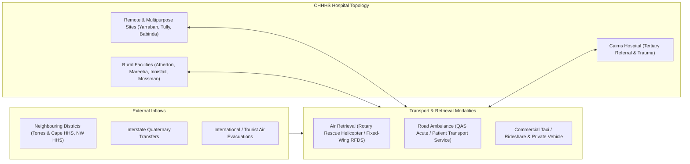

# Transport, Retrieval & Interfacility Boundary Flows

## Overview

Regional health services (such as Cairns and Hinterland Hospital and Health Service, CHHHS) operate as distributed networks connected by road and air transport corridors. Patients move continuously between primary community settings, rural multipurpose facilities, and tertiary referral centres.



---

## 1. Transport Modalities

| Modality | Fleet Operator | Operating Domain | Speed & Range | Space/Equipment Profile |
|---|---|---|---|---|
| **Road Ambulance (Acute)** | Queensland Ambulance Service (QAS) | Urban & regional sealed road corridors | Mean $60 - 90\text{ km/h}$, radius $\le 150\text{ km}$ | 1 Stretcher + monitor/defib + emergency medications |
| **Non-Acute Patient Transport** | QAS PTS / Hospital Transport Van | Low-acuity step-down transfers | Mean $50 - 70\text{ km/h}$ | Seated / wheel-chair / multi-passenger capability |
| **Rotary-Wing Air Ambulance** | Rescue Helicopter (e.g. Rescue 510) | Time-critical rural/remote trauma, oceanic, bush retrieval | Mean $220\text{ km/h}$, radius $\approx 250\text{ km}$ | 1 Intensive care stretcher + ventilator + infusion pumps |
| **Fixed-Wing Air Retrieval** | Royal Flying Doctor Service (RFDS) | Long-range inter-facility & remote airstrip transfers | Mean $450\text{ km/h}$, range $\ge 1,000\text{ km}$ | 2 Intensive care stretchers + neonatal transport cot |
| **Commercial / Rideshare** | Taxi / Uber / Community Bus | Ambulatory outpatients & self-discharging inpatients | Urban traffic distributions | Non-clinical seated capacity |
| **Private Vehicle** | Patient family / self-presentation | Walk-in ED & elective admissions | Local road distribution | Zero clinical equipment |

---

## 2. Crew Capabilities & Transport Streams

Clinical escort requirements tie up skilled staff and determine dispatch latency:

| Crew Stream | Clinical Capability | Authorized Triage Levels | Escort Constraints |
|---|---|---|---|
| **Patient Transport Officer (EMT)** | Basic life support, vital signs, mobility assistance | ATS 5, Priority 3 Transfers | Single driver + single attendant |
| **Advanced Care Paramedic (ACP)** | Advanced airway, pharmacology, IV cannulation, cardiac monitoring | ATS 2–4, Priority 2 Transfers | Standard two-paramedic crew |
| **Critical Care Paramedic (CCP)** | Rapid sequence intubation (RSI), arterial lines, advanced hemodynamic support | ATS 1–2, Priority 1–2 Transfers | Dual CCP or CCP + ACP |
| **Medical Retrieval Team (MRT)** | Emergency/ICU Consultant or Registrar + Flight Nurse | ATS 1, Priority 1 Aeromedical, Neonatal NETS | Dedicated retrieval service (Retriever call-in latency applies) |

---

## 3. Boundary & Cross-Border Flows

To accurately capture regional hospital bed demand, `careops-network` models four boundary inflow/outflow interfaces:

### 3.1 Intra-District Transfers (CHHHS Internal Network)
- **Escalation**: Rural hospitals (Atherton, Mareeba, Innisfail, Mossman) transfer complex surgical, obstetric, and intensive care cases to Cairns Base Hospital.
- **Step-Down / Repatriation**: Cairns Hospital discharges recovering subacute, rehabilitation, and palliative patients back to rural community beds to free tertiary capacity.

### 3.2 Neighboring District Inflows (Torres and Cape HHS, North West HHS)
- Cairns Hospital serves as the primary tertiary referral center for Torres and Cape HHS (Cape York Peninsula and Torres Strait Islands) and secondary overflow for Mount Isa / North West HHS.
- Modeled as stochastic aeromedical arrivals into Cairns ED, ICU, and surgical suites via RFDS with higher baseline comorbidities and complex logistics.

### 3.3 Interstate Transfers (Quaternary Repatriations)
- Low volume, highly specialized flows:
  - Outflow: Cairns patients requiring organ transplantation, severe pediatric burns, or complex ECMO transferred to Brisbane (Queensland Children's Hospital, The Prince Charles Hospital, RBWH).
  - Inflow: Repatriation of stabilized patients returning from interstate quaternary admissions back to Cairns wards.

### 3.4 International & Tourist Admissions
- Cairns is a major international tourism hub (Great Barrier Reef, Daintree) with an international airport.
- Modeled as low-volume, acute presentations (decompression sickness / hyperbaric chamber needs, tropical infectious diseases, marine stings, trauma) presenting directly to ED via QAS or direct walk-in.

---

## 4. Primary, Private & Aged Care Community Interfaces

Hospital networks do not operate in isolation; demand, flow, and bed availability are continuously shaped by interactions with the primary, private, and aged care sectors:

```mermaid
flowchart TD
    subgraph Community["Primary & Community Care"]
        GP["General Practice (Primary Care)"]
        UCC["Medicare Urgent Care Clinics (UCC)"]
        PrivSpec["Private Specialist Suites"]
        RACF["Residential Aged Care Facilities (RACF)"]
    end

    subgraph PrivateSector["Private Hospital Sector"]
        PrivHosp["Private Hospitals (e.g. Cairns Private)"]
    end

    subgraph PublicSystem["Public Hospital Campus (CHHHS)"]
        ED["Emergency Department"]
        AMAU["Acute Medical Assessment Unit"]
        Surg["Operating Theatres & ESWL"]
        Wards["Inpatient Acute & Subacute Wards"]
        SOPD["Specialist Outpatient Clinics"]
    end

    GP -->|Referral (CPC)| SOPD
    GP -->|Direct Warm Handover| ED & AMAU
    UCC -->|Diverts Low-Acuity ATS 4-5| Community
    UCC -->|Escalation / Deterioration| ED
    PrivSpec -->|Uninsured ESWL Referral| Surg
    PrivHosp <-->|Public-Private Outsourcing / Escalation| PublicSystem
    RACF -->|High-Frailty Acute Inflow (QAS)| ED
    Wards -->|Delayed Discharge / ACAT Block| RACF
```

### 4.1 Private Hospital Sector (e.g. Cairns Private Hospital)
- **Public-Private Elective Outsourcing**: Public health services contract private hospitals to perform Category 2 and 3 elective procedures under NHRA treat-in-private initiatives to prevent waitlist breaches.
- **Private-to-Public Escalation**: Private hospital patients who decompensate post-operatively (requiring tertiary intensive care, interventional radiology, or multi-organ support) are transferred via QAS to the public tertiary hospital.
- **Public-to-Private Insured Transfers**: During severe public acute bed-block crises, clinically stable privately-insured public inpatients are transferred to private partner beds.

### 4.2 General Practice (GP) & Primary Care
- **Outpatient Referral Funnel**: GPs generate the primary inflow of referrals into Specialist Outpatient Clinics (SOPD) via Queensland Health Clinical Priority Criteria (CPC).
- **Direct Emergency Referrals**: GPs initiate direct ambulance dispatch or provide warm-handover clinical referrals directly to ED or Acute Medical Assessment Units (AMAU), bypassing triage waiting rooms for pre-assessed patients.
- **Community Discharge Step-Down**: Patients discharged from acute wards return to GP care with discharge summaries; failure of community follow-up drives 30-day readmission risk.

### 4.3 Private Specialist Practices
- **Public Waitlist Seeding**: Uninsured or underinsured patients evaluated in private specialist consulting rooms are referred directly onto public Elective Surgery Waiting Lists (ESWL) with established clinical categories.
- **Shared-Care Antenatal Streams**: Low-risk pregnant women managed in private GP-obstetrician shared-care models present to the public birthing suite only for intrapartum labor and delivery.

### 4.4 Urgent Care Clinics (Medicare UCCs & Rapid Access Clinics)
- **Low-Acuity ED Diversion**: Walk-in presentations classified as ATS 4 and 5 (simple fractures, minor lacerations, mild respiratory/viral infections) are diverted to Medicare Urgent Care Clinics, relieving ED waiting room crowding.
- **Urgent Care Escalation / Protocolized Transfer**: When a UCC presentation exceeds clinic capabilities (e.g. acute surgical abdomen, persistent chest pain, hemodynamic instability), the clinic triggers an expedited QAS ambulance transfer directly into the public ED resuscitation/acute bays.

### 4.5 Residential Aged Care Facilities (RACF) & Disability Accommodation
- **High-Frailty Emergency Inflows**: High-volume acute transfer stream into ED (falls, hip fractures, delirium, sepsis, aspiration pneumonia, palliative crises) transported via QAS.
- **Community Outreach & Avoidance**: Geriatric Emergency Department Intervention (GEDI) and Hospital in the Nursing Home (HITH) programs deploy outreach nurses/geriatricians to manage exacerbations in the RACF, avoiding hospital transfer.
- **Delayed Discharge & RACF Placement Block**: Inpatients whose acute medical treatment has concluded but who require a new or upgraded RACF bed (awaiting Aged Care Assessment Team [ACAT] approvals, guardianship orders, or facility vacancies). This is a primary driver of acute bed-blocking, inflating hospital length-of-stay and backing up ED boarding queues.
