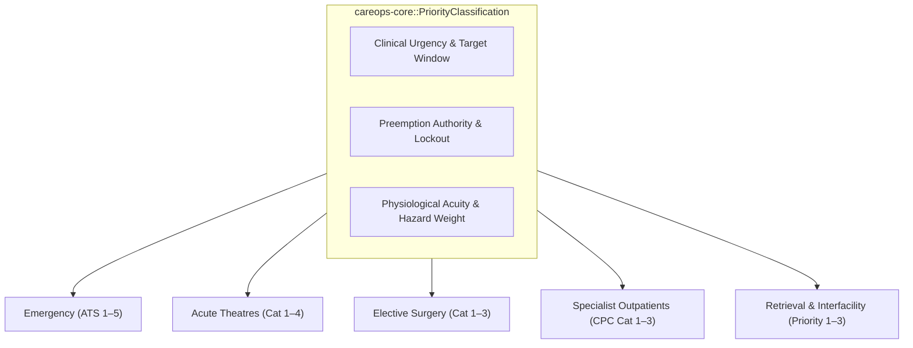

# Universal Triage & Priority Framework

## Overview

A fundamental challenge in whole-of-health simulation is reconciling the divergent priority and urgency scoring systems across emergency, operative, inpatient, ambulatory, and retrieval contexts. In `careops-sim` and `careops-core`, priority is formalized as a unified, typed multi-axis contract: **Acuity (clinical hazard rate)**, **Time-to-Service Target (delay penalty)**, and **Preemption Tier (override authorization)**.



---

## 1. Setting-Specific Triage Mappings

### 1.1 Emergency Department: Australasian Triage Scale (ATS)
| Category | Clinical Description | Maximum Waiting Time | Preemption Tier |
|---|---|---|---|
| **ATS 1** | Resuscitation / Immediate life threat | Immediate ($0\text{ min}$) | Level 1: Crash Preemption |
| **ATS 2** | Emergency / Imminently life-threatening | $10\text{ min}$ | Level 2: Immediate Allocation |
| **ATS 3** | Urgent / Potentially life-threatening | $30\text{ min}$ | Level 3: Priority FIFO |
| **ATS 4** | Semi-urgent / Potentially serious | $60\text{ min}$ | Level 4: Standard FIFO |
| **ATS 5** | Non-urgent / Minor conditions | $120\text{ min}$ | Level 5: Deferrable |

### 1.2 Acute Operating Theatres: Emergency Surgical Urgency
| Category | Clinical Urgency | Target Decision-to-Incision | Preemption Mechanics |
|---|---|---|---|
| **Cat 1** | Critical / Life or limb threatening (e.g. crash caesarean, ruptured AAA) | $\le 30\text{ min}$ | Immediate preemption of elective theatre lists; calls on-call theatre team |
| **Cat 2** | Urgent (e.g. acute appendicitis, irreducible hernia, urgent fracture) | $\le 75\text{ min} - 2\text{ hours}$ | First available acute emergency theatre; overrides planned day surgery |
| **Cat 3** | Priority (e.g. stable perianal abscess, closed fracture fixation) | $\le 24\text{ hours}$ | Scheduled into dedicated acute emergency session (NCEPOD / CEPOD list) |
| **Cat 4** | Elective overflow / semi-urgent inpatient | Scheduled slot | Fill gaps in daytime emergency capacity |

### 1.3 Elective Surgery Waiting List (ESWL)
| Category | Clinical Description | Clinically Recommended Time | Performance Benchmark |
|---|---|---|---|
| **Cat 1** | Urgent (condition likely to deteriorate quickly, e.g. suspected malignancy) | $\le 30\text{ days}$ | $> 98\%$ treated in time |
| **Cat 2** | Semi-urgent (causes pain/disability but unlikely to become emergency immediately) | $\le 90\text{ days}$ | $> 95\%$ treated in time |
| **Cat 3** | Routine / non-urgent (minimal pain, disability, or progression) | $\le 365\text{ days}$ | $> 95\%$ treated in time |

### 1.4 Specialist Outpatient Clinics (SOPD / CPC)
| Category | Clinical Urgency (CPC Protocol) | Recommended Access Window | Registry Behavior |
|---|---|---|---|
| **Cat 1** | Urgent outpatient assessment (e.g. abnormal screening, rapid decline) | $\le 30\text{ days}$ | Fast-track slot reservation; overbooking tolerance |
| **Cat 2** | Semi-urgent (specialist opinion needed for chronic management adjustment) | $\le 90\text{ days}$ | Standard clinic template allocation |
| **Cat 3** | Routine specialist assessment | $\le 365\text{ days}$ | Backlog buffer; audit churn and cancellation dropouts |

### 1.5 Aeromedical Retrieval & Interfacility Transport
| Category | Operational Profile | Response & Transport Target | Crew Requirement |
|---|---|---|---|
| **Priority 1** | Critical aeromedical retrieval / acute primary mission (e.g. major trauma, Cat 1 birth) | Immediate launch ($\le 30\text{ min}$) | Medical Retrieval Team (Doctor + Critical Care Flight Nurse) |
| **Priority 2** | Urgent inter-facility transfer (e.g. deteriorating rural inpatient to tertiary ICU) | Dispatch $\le 60 - 120\text{ min}$ | Advanced Care / Critical Care Paramedic Crew |
| **Priority 3** | Non-urgent / routine transfer (e.g. repatriation from Cairns Base to Atherton subacute) | Scheduled within $24\text{ hours}$ | Patient Transport Officer / EMT Crew or Commercial/Taxi |

### 1.6 Community, Urgent Care & Frailty Triage Protocols
| Protocol | Target Cohort | Clinical Logic | Operational Action |
|---|---|---|---|
| **Urgent Care Diversion** | Non-acute walk-in presentations (ATS 4–5) | Absence of red-flag vitals, chest pain, or surgical abdomen | Diverted to Medicare Urgent Care Clinic; returns to community |
| **Geriatric Emergency (GEDI / CFS)** | Frail older adults ($\ge 65$) presenting from RACF / home | Clinical Frailty Scale (CFS $\ge 5$), delirium, fall risk | Bypasses standard ward queue to specialized multidisciplinary review or HITH outreach |
| **Private-to-Public Critical Escalation** | Post-op or medical decompensation in private hospital | Deteriorating NEWS/MEWS, mechanical ventilation, shock | Direct consultant-to-consultant handover directly into tertiary ICU / Theatre, bypassing ED triage |

---

## 2. Core Scheduling & Preemption Behavior

In `careops-core`, priority is represented as a composable struct:
```rust
pub struct PriorityRecord {
    pub domain_category: DomainPriorityCategory, // ATS, TheatreCat, ESWLCat, etc.
    pub target_window: SimDuration,
    pub preemption_tier: u8,
    pub delay_penalty_weight: f64,
}
```

- **Short-Horizon Flow Queues** use `preemption_tier` combined with Kairos `PreemptiveResource` to determine whether an in-flight server (theatre, midwife, trauma bay) must be immediately interrupted.
- **Long-Horizon Registries** use `target_window` to compute breach risk scoring ($\frac{\text{CurrentWait}}{\text{RecommendedWindow}}$) driving dynamic list prioritization.
