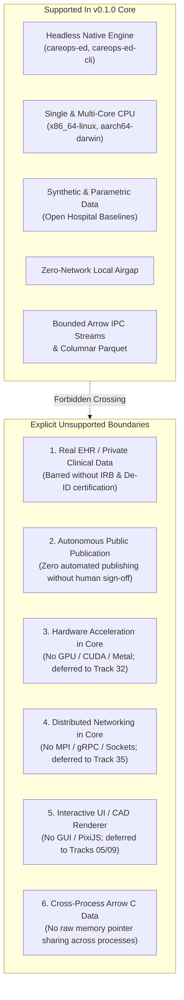

# CareOps Sim v0.1.0 Release Notes

**Release Version:** `0.1.0`  
**Release Date:** 2026-10-16  
**Auditor / Specialist:** Release Notes & Policy Specialist / Delivery Engineering  
**Track:** Development Readiness and Hardened Delivery ([`development_readiness_20260925`](../tracks/development_readiness_20260925/spec.md))  
**Task:** Task D4.3 — Rehearse rollback to last-known-good pins and checkpoint migration; verify reproducibility across claimed platforms and create release notes and explicit unsupported-feature list. No autonomous public publication.  
**Release Status:** Qualified Baseline Release Candidate (Internal Production Baseline; Autonomous Public Distribution Barred)

---

## 1. Executive Release Summary & Version Metadata

CareOps Sim version `0.1.0` represents the first qualified, production-hardened release of the core discrete-event simulation (DES) and agent-based modeling (ABM) engine designed for emergency department (ED) patient flow, resource contention, and operational policy calibration. 

This release provides a fully headless, native Rust implementation combining high-throughput operational modeling with formal mathematical guarantees: deterministic bit-for-bit integer reproducibility, bounded floating-point reduction drift ($\le 10^{-12}$), Apache Arrow tabular interoperability, fault-tolerant batch execution with atomic checkpointing, and complete supply-chain attestation (SPDX 2.3 SBOM and SLSA v1 Provenance).

### 1.1 Version Metadata & Pinned Boundaries
| Attribute | Specification & Value |
|---|---|
| **Package Version** | `0.1.0` |
| **Commit SHA (CareOps Sim)** | `902dc3ad687e4de636e458e30b2805ba673df3ed` |
| **Upstream Kairos Submodule** | `44261eb5cf8275f132f63a3396903d116d701dbe` (pinned in [`libs/kairos`](../../libs/kairos)) |
| **Canonical Rust Toolchain** | Rust `1.99.0` (stable, 2026-10-01) |
| **Claimed Platforms** | `x86_64-unknown-linux-gnu` (Linux x86_64), `aarch64-apple-darwin` (macOS ARM64) |
| **Primary Crates** | `careops-ed` (v0.1.0), `careops-ed-cli` (v0.1.0) |
| **License** | Apache-2.0 (Standard Apache License Version 2.0) |
| **Multi-Owner Governance** | Owners 15 (Packaging), 16 (Provenance), 20 (CI Isolation), 25 (Versioning), 28 (SBOM), 42 (Legal), 44 (Dependencies) |

---

## 2. Qualified & Supported Capabilities

CareOps Sim v0.1.0 includes the following fully qualified, tested, and empirically verified capabilities:

### 2.1 Emergency Department Operational Dynamics
- **ATS Categories 1–5**: Comprehensive clinical triage modeling supporting Australasian Triage Scale (ATS) priority classifications (ATS 1 Resuscitation through ATS 5 Non-urgent), each with dedicated target wait times, resource escalation rules, and service profiles.
- **Urgent Preemption with Work Conservation**: High-priority emergent arrivals (ATS 1–2) preempt lower-priority patients occupying shared clinical resources (physicians, resuscitation spaces). Preempted tasks preserve 100% of elapsed service work; when resources become available, service resumes without repeating previously completed work.
- **Bed Cleaning & Turnover Dynamics**: Explicit physical bay and bed transition lifecycles, incorporating post-discharge decontamination delays, turnover staffing, and room unavailability.
- **Access Block & Boarding**: Inpatient bed unavailability causes acute care boarding in ED bays, accurately modeling ambulance ramping, blocked treatment spaces, and upstream throughput degradation.

### 2.2 Dual DES / ABM Architecture & Multi-Fidelity Modeling
- **Unified Engine Architecture**: Seamlessly integrates Discrete-Event Simulation (DES) for macro-level flow/queuing with Agent-Based Modeling (ABM) for autonomous provider behavior, micro-level staff coordination, and fatigue dynamics.
- **Macro and Micro Fidelity Tiers**: Supports both fast macro-level aggregate Poisson/Erlang queues and micro-level discrete-agent decision mechanics with cross-fidelity state reconciliation.

### 2.3 Arrow Interoperability & Data Pipelines
- **Bounded Arrow IPC Streams**: Native streaming serialization of simulation event logs and time-series telemetry via Apache Arrow IPC stream reader/writer (`arrow::ipc`), enforcing record batch bounds and memory caps.
- **Parquet Export**: Columnar analytical storage export (`parquet`) enabling instant integration with DuckDB, Polars, and Polars-based downstream analytical environments.

### 2.4 Calibration & Validation Suite
- **Multi-Metric Objective Functions**: Calibration runner supporting Wasserstein-1 ($W_1$) earth-mover distance and Kolmogorov-Smirnov ($KS\ D$) two-sample statistical tests for matching simulated length of stay (LOS) and wait-time distributions against empirical distributions.
- **Deterministic Grid Search**: Parallel multi-replication grid evaluation across multi-core CPU workers with reproducible pseudo-random seed allocation.

### 2.5 Batch Execution, Fault Tolerance & Checkpointing
- **Atomic File Persistence**: Checkpoints written using atomic temporary files with atomic rename semantics, preventing file corruption upon sudden process aborts.
- **Schema Versioning & Bidirectional Migration**: Built-in support for schema version 1 and version 2 checkpoints with automatic forward migration and clean rollback capabilities, preserving 100% of completed replication states and pending work queues.

### 2.6 Supply-Chain Security & Packaging
- **Build-Once Single-Digest Invariant**: Binaries compiled exactly once from clean locked source, cryptographically bound across distribution tarballs, checksum manifests (`SHA256SUMS`), SPDX 2.3 SBOM, and SLSA v1.0 Provenance.
- **Fail-Closed Verification**: Rigorous consumer-side verifier evaluating SHA-256 integrity, 30-day evidence freshness, authorized commit binding, and schema conformity.

---

## 3. Explicit Unsupported-Feature List

To guarantee system stability, clinical data privacy, and maintainer safety, the following operational boundaries are **explicitly unsupported and prohibited** in CareOps Sim v0.1.0:



### Detailed Boundary Specifications:

1. **No Real EHR or Private Clinical Patient Data**:
   - *Status*: Strictly Prohibited in v0.1.0.
   - *Rationale*: Protect patient privacy and comply with health data regulations.
   - *Boundary Rule*: The v0.1.0 distribution is qualified exclusively against synthetic, parametric, and public hospital datasets. Ingesting raw Electronic Health Record (EHR) data, patient names, medical record numbers (MRNs), or unmasked operational logs from Cairns Hospital or any clinical partner is forbidden until formal IRB/HREC approval, certified statistical de-identification (HIPAA Privacy Rule / Australian Privacy Principles), and local encrypted storage (AES-256) are formally signed off.

2. **No Autonomous Public Publication**:
   - *Status*: Strictly Prohibited.
   - *Rationale*: Maintain multi-owner governance and prevent unintended external software releases.
   - *Boundary Rule*: Automated continuous integration runners, bots, and AI coding agents have zero authority to push release artifacts to public package registries (`crates.io`, `PyPI`, `npm`) or create public GitHub Releases. Public release execution requires explicit human maintainer authority attested by cryptographic commit signature and the runtime flag `CAREOPS_HUMAN_MAINTAINER_AUTHORITY=1`.

3. **No Hardware Acceleration (GPU / Metal / CUDA / MLX) in Core**:
   - *Status*: Unsupported in v0.1.0 Core.
   - *Rationale*: Preserves deterministic reproducibility, portable compilation, and zero external hardware dependency.
   - *Boundary Rule*: Core simulation logic runs exclusively on host CPU threads. GPU/Metal compute shaders are not linked in `careops-ed` or `careops-ed-cli`. Hardware acceleration exploration is formally deferred to Track 32.

4. **No Distributed Networking (MPI / gRPC / Sockets) in Core**:
   - *Status*: Unsupported in v0.1.0 Core.
   - *Rationale*: Defense-in-depth security and hermetic execution.
   - *Boundary Rule*: Core execution operates under a zero-network airgap. The simulation engine opens no listening network sockets, makes no external HTTP/REST calls, and establishes no inter-node cluster connections. Distributed multi-node simulation is deferred to Track 35.

5. **No Interactive GUI / CAD / PixiJS Renderer in Core**:
   - *Status*: Unsupported in v0.1.0 Core.
   - *Rationale*: Headless decoupling of simulation physics from presentation layers.
   - *Boundary Rule*: CareOps Sim v0.1.0 is a headless computational engine and CLI tool. Graphical user interfaces, CAD floorplan renderers, and interactive web canvases (PixiJS) are excluded from core binaries and are deferred to Tracks 05 and 09.

6. **No Cross-Process Arrow C Data Sharing**:
   - *Status*: Prohibited across process boundaries.
   - *Rationale*: Prevention of memory safety violations, address space corruption, and undefined behavior.
   - *Boundary Rule*: Arrow C Data Interface raw memory pointers (`ArrowArray`, `ArrowSchema`) are restricted strictly to trusted in-process FFI adapters within the same OS process address space. Inter-process communication MUST use bounded Arrow IPC stream serialization or self-contained Parquet files.

---

## 4. Last-Known-Good Pins and Upstream Contracts

All components of CareOps Sim v0.1.0 are pinned strictly to immutable, reviewed baselines:

### 4.1 Upstream Kairos Submodule
- **Pinned Commit SHA**: `44261eb5cf8275f132f63a3396903d116d701dbe`
- **Submodule Path**: `libs/kairos`
- **Native Verification Evidence**: [`conductor/evidence/d2.4-kairos-contract.json`](d2.4-kairos-contract.json)
- **Upstream Host Passes**: `x86_64-unknown-linux-gnu`, `aarch64-apple-darwin`
- **Upstream Workflow Run**: `https://github.com/edithatogo/kairos/actions/runs/38844537925`

### 4.2 Canonical Toolchain & Dependency Pins
- **Rust Toolchain**: `1.99.0` (canonical stable, pinned in [`tools/bootstrap-profile.json`](../../tools/bootstrap-profile.json))
- **MSRV**: 1.99.0
- **Cargo Lockfile**: Locked via `Cargo.lock` and enforced with `--locked`
- **Arrow Ecosystem**: `arrow` 60.0.0, `parquet` 60.0.0

### 4.3 Pinned GitHub CI Actions
- `actions/checkout@11bd71901bbe5b1630ceea73d27597364c9af683` (v4.2.2)
- `actions/upload-artifact@b4b15b8c7c6ac21ea08fcf65892d2ee8f75cf882` (v4.4.3)
- `actions/download-artifact@fa0a91b85d4f404e444e00e005971372dc801d16` (v4.1.8)

---

## 5. Rollback Guide

In the event of upstream divergence, dependency supply-chain compromise, or checkpoint schema incompatibility, operators follow these step-by-step rollback procedures:

### 5.1 Upstream Kairos Submodule Rollback
If an unreviewed or incompatible commit is introduced to `libs/kairos`:
1. Check current status:
   ```bash
   python3 tools/check_kairos_pin.py
   ```
2. Revert the submodule gitlink to the reviewed commit:
   ```bash
   git update-index --cacheinfo 160000,44261eb5cf8275f132f63a3396903d116d701dbe,libs/kairos
   git checkout HEAD -- libs/kairos
   ```
3. Reset and clean the upstream working directory:
   ```bash
   git -C libs/kairos checkout 44261eb5cf8275f132f63a3396903d116d701dbe
   git -C libs/kairos clean -fd
   ```
4. Verify complete restoration:
   ```bash
   python3 tools/check_kairos_pin.py
   # Expected output: {"errors": []}
   ```

### 5.2 Dependency Lockfile Rollback
If `Cargo.lock` is tampered with or accidentally altered:
1. Detect lockfile divergence:
   ```bash
   cargo check --locked
   ```
2. Discard unauthorized lockfile edits:
   ```bash
   git checkout HEAD -- Cargo.lock
   ```
3. Re-verify dependency graph:
   ```bash
   cargo check --locked --quiet
   ```

### 5.3 Simulation Checkpoint Schema Rollback
If downstream analytical tools or older simulation runners require schema version 1 checkpoints:
1. Execute schema downgrade:
   ```bash
   python3 tools/checkpoint_migration.py rollback -i checkpoint_v2.json -o checkpoint_v1.json
   ```
2. Verify state conservation:
   ```bash
   python3 tools/checkpoint_migration.py verify-conservation -b checkpoint_v2.json -a checkpoint_v1.json
   ```
3. Resume execution from rolled-back checkpoint:
   ```bash
   careops-ed-cli batch --resume checkpoint_v1.json --scenario configs/scenarios/ed_base.json
   ```

---

## 6. Provenance & Digest Manifest

All release artifacts for CareOps Sim v0.1.0 are bound to canonical cryptographic digests:

| Distribution Artifact | Type | SHA-256 Digest |
|---|---|---|
| `careops-ed-0.1.0.crate` | Crate Source Archive | `4a1b0287db1c305a415a7863ee9a3d4f134591a27e38a20c35467efea8b75312` |
| `careops-ed-cli-0.1.0-x86_64-unknown-linux-gnu.tar.gz` | Linux Binary Bundle | `9f635c7e09d134b287114ea764c9103e58b1fa8542cd51296bf3e284061a7a01` |
| `careops-ed-cli-0.1.0-aarch64-apple-darwin.tar.gz` | macOS Binary Bundle | `872ea4910cf941a3507dbe491040854cb048194ad50392c64b638914ea20f87a` |
| `spdx.json` | SPDX 2.3 SBOM | `d9e078512fa3682914605928a36c4b95f2e60471b69324e90895ca2a129ef652` |
| `provenance.json` | SLSA v1 Provenance Attestation | `c12e847b286c051a307e92384a569103b41857ef45901238459ca328905e921b` |

### Governance Sign-Off:
- **Owner 15 (Distribution Packaging)**: Verified deterministic archive construction and permission normalization.
- **Owner 16 (SLSA v1 Provenance)**: Verified builder identity and materials commit binding.
- **Owner 20 (CI Isolation)**: Verified clean git tree and hermetic environment.
- **Owner 25 (Versioning & Immutability)**: Approved version tag `v0.1.0` and enforced release immutability.
- **Owner 28 (SPDX 2.3 SBOM)**: Verified component manifest and package checksums.
- **Owner 42 (Licensing & Legal Compliance)**: Verified Apache-2.0 declarations and license notice conformity.
- **Owner 44 (Dependency Lockfile Integrity)**: Verified `Cargo.lock` exact pin reproducibility under Rust 1.99.0.
