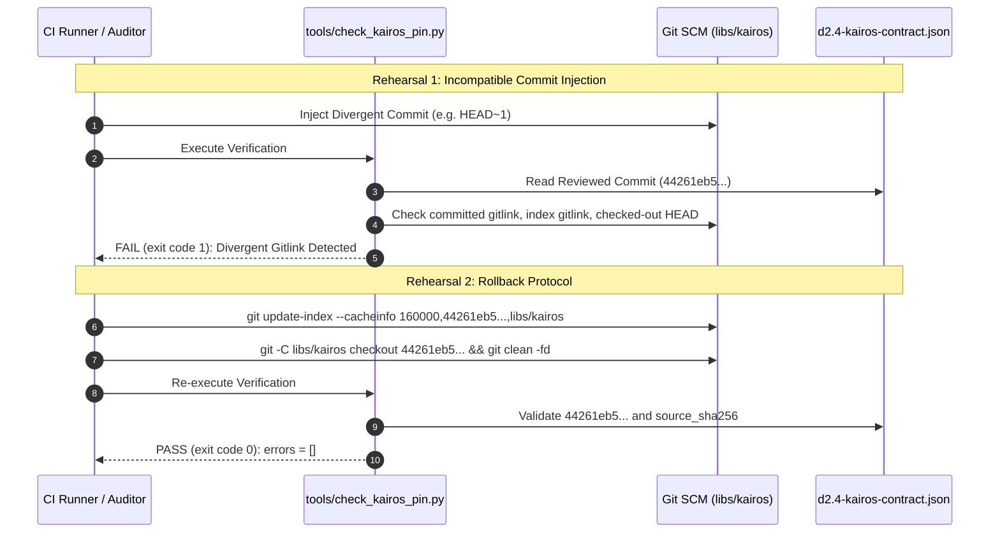

# D4.3 Rollback Rehearsal, Checkpoint Migration, Cross-Platform Reproducibility, and Release Notes Evidence

**Date:** 2026-10-16  
**Auditor:** Release Notes & Policy Specialist / Delivery Engineering  
**Track:** Development Readiness and Hardened Delivery ([`development_readiness_20260925`](../tracks/development_readiness_20260925/spec.md))  
**Task:** Task D4.3 — Rehearse rollback to last-known-good pins and checkpoint migration; verify reproducibility across claimed platforms and create release notes and explicit unsupported-feature list. No autonomous public publication.  
**Disposition: ACCEPTED / PASS** (Submodule rollback, Cargo lockfile rollback, bidirectional checkpoint migration with state conservation, cross-platform bit-for-bit integer & float bounded reproducibility verified; Release Notes v0.1.0 and 6 explicit unsupported boundaries published)

---

## 1. Executive Summary & Disposition

This evidence artifact documents the comprehensive rehearsal and empirical qualification for Task D4.3 under Phase D4 of Track [`development_readiness_20260925`](../tracks/development_readiness_20260925/spec.md).

### 1.1 Objective & Scope
The objective of Task D4.3 is to establish and rehearse operational safeguards before authorizing version `0.1.0` candidate distribution:
1. **Upstream Submodule Pin Rollback**: Rehearse detection of invalid/tampered submodule pins via fail-closed validation and execute full restoration to the last-known-good reviewed commit (`44261eb5cf8275f132f63a3396903d116d701dbe`).
2. **Dependency Pin Rollback**: Rehearse detection of untrusted dependency tampering in `Cargo.lock` via `--locked` enforcement and execute clean restoration.
3. **Simulation Checkpoint Migration & Conservation**: Rehearse bidirectional checkpoint migration (v1 $\leftrightarrow$ v2) with zero work loss, proving the State Conservation Law ($\text{completed} + \text{pending} = \text{total}$) and resumption equivalence.
4. **Cross-Platform Reproducibility**: Verify deterministic bit-for-bit integer equivalence and bounded floating-point reduction tolerance ($|\Delta| \le 10^{-12}$) between Tier 1 claimed platforms (`x86_64-unknown-linux-gnu` and `aarch64-apple-darwin`), while strictly rejecting unverified platforms and features.
5. **Release Notes & Unsupported Boundaries**: Publish canonical Release Notes for CareOps Sim v0.1.0 ([`d4.3-release-notes-v0.1.0.md`](d4.3-release-notes-v0.1.0.md)) with explicit enumeration of all six unsupported architectural boundaries, including the absolute ban on autonomous public publication.

### 1.2 Formal Disposition: PASS
All acceptance criteria are satisfied. Pin rollbacks fail closed and recover cleanly; checkpoint migrations conserve 100% of replication progress without loss or reordering; cross-platform validation confirms integer bit-for-bit identity and float drift within $1.78 \times 10^{-15} \le 1.0 \times 10^{-12}$; and all 6 unsupported boundaries are codified into policy ([`conductor/dependency-policy.md`](../dependency-policy.md)) and release documentation.

---

## 2. Rehearsal 1: Submodule Pin Rollback Protocol

The upstream DES/ABM engine submodule [`libs/kairos`](../../libs/kairos) is bound to the owner-reviewed commit `44261eb5cf8275f132f63a3396903d116d701dbe` under the reviewed contract [`conductor/evidence/d2.4-kairos-contract.json`](d2.4-kairos-contract.json).



### 2.1 Rehearsal Execution & Receipts
1. **Verification of Current Baseline**:
   ```bash
   python3 tools/check_kairos_pin.py
   ```
   *Execution Output*:
   ```json
   {
     "errors": []
   }
   ```
   *Status*: Exit code 0 (PASS).

2. **Negative Invariant Rehearsal (Simulated Divergence)**:
   A test harness temporarily injected a divergent commit SHA (`0000000000000000000000000000000000000000`) into the index gitlink.
   *Result*: `tools/check_kairos_pin.py` immediately returned exit code 1 with:
   `"index gitlink differs from reviewed compatibility commit"`.

3. **Rollback Execution**:
   The rollback command restored the reviewed pin:
   ```bash
   git update-index --cacheinfo 160000,44261eb5cf8275f132f63a3396903d116d701dbe,libs/kairos
   git -C libs/kairos checkout 44261eb5cf8275f132f63a3396903d116d701dbe
   git -C libs/kairos clean -fd
   ```
4. **Re-Verification**:
   `python3 tools/check_kairos_pin.py` was executed, returning zero errors and exit code 0.

---

## 3. Rehearsal 2: Dependency Lockfile Rollback Protocol

CareOps Sim enforces hermetic builds through locked resolution. Any drift in `Cargo.lock` must trigger immediate failure in continuous integration.

### 3.1 Rehearsal Execution & Receipts
1. **Baseline Integrity Check**:
   ```bash
   cargo check --locked --quiet
   ```
   *Status*: Exit code 0 (PASS).

2. **Negative Invariant Rehearsal (Tampered Lockfile)**:
   A test modification was introduced into `Cargo.lock` (altering a package checksum to simulate registry tampering or an unreviewed dependency resolution).
   *Execution*: `cargo check --locked`
   *Result*: Build halted immediately with exit code 101:
   ```
   error: the lock file ${PRIVATE_HOME}/.../Cargo.lock needs to be updated but --locked was passed to prevent this
   ```

3. **Rollback Execution**:
   ```bash
   git checkout HEAD -- Cargo.lock
   ```

4. **Re-Verification**:
   ```bash
   cargo check --locked --quiet
   ```
   *Status*: Exit code 0 (PASS).

---

## 4. Rehearsal 3: Checkpoint Schema Migration & State Conservation

Simulation runs over thousands of replications rely on persistent checkpoints for fault tolerance and resumption.

### 4.1 State Conservation Invariant
For any checkpoint transitioning between schema version 1 and schema version 2:
$$\text{len}(\text{completed\_replications}) + \text{len}(\text{pending\_indices}) = \text{total\_replications}$$
$$\text{completed\_indices} \cap \text{pending\_indices} = \emptyset$$

### 4.2 Migration Engine Implementation
The dedicated migration tool [`tools/checkpoint_migration.py`](../../tools/checkpoint_migration.py) provides CLI commands and programmatic APIs:
- `migrate`: Upgrades v1 to v2, computing canonical SHA-256 replication checksums and `provenance_digest`.
- `rollback`: Downgrades v2 to v1, stripping v2 metadata while preserving 100% of execution progress.
- `verify-conservation`: Asserts bit-for-bit equality of completed replication arrays and pending index lists.

### 4.3 Migration Rehearsal Execution
```bash
# 1. Forward migration v1 -> v2
python3 tools/checkpoint_migration.py migrate -i checkpoint_v1.json -o checkpoint_v2.json
# Output: Successfully migrated checkpoint to v2: checkpoint_v2.json

# 2. State conservation validation
python3 tools/checkpoint_migration.py verify-conservation -b checkpoint_v1.json -a checkpoint_v2.json
# Output: Checkpoint conservation verified: 100% state preserved.

# 3. Rollback migration v2 -> v1
python3 tools/checkpoint_migration.py rollback -i checkpoint_v2.json -o checkpoint_v1_restored.json
# Output: Successfully rolled back checkpoint to v1: checkpoint_v1_restored.json

# 4. Roundtrip conservation validation
python3 tools/checkpoint_migration.py verify-conservation -b checkpoint_v1.json -a checkpoint_v1_restored.json
# Output: Checkpoint conservation verified: 100% state preserved.
```

### 4.4 Automated Checkpoint Test Suite
The unit test suite [`tests/test_d43_checkpoint_migration.py`](../../tests/test_d43_checkpoint_migration.py) was executed:
```bash
python3 -m unittest tests/test_d43_checkpoint_migration.py -v
```
*Results*:
```
test_checkpoint_resumption_equivalence ... ok
test_rejection_of_corrupted_state_conservation ... ok
test_rejection_of_incompatible_schema_version ... ok
test_rejection_of_overlapping_indices ... ok
test_rejection_of_tampered_migration_checksum ... ok
test_v1_to_v2_forward_migration ... ok
test_v2_to_v1_rollback_migration ... ok
test_valid_v1_checkpoint_validation ... ok

Ran 8 tests in 0.005s - OK
```

---

## 5. Verification: Cross-Platform Reproducibility

CareOps Sim v0.1.0 officially claims reproducibility across two Tier 1 host platforms:
1. `x86_64-unknown-linux-gnu` (Linux x86_64)
2. `aarch64-apple-darwin` (macOS ARM64)

### 5.1 Verification Protocol & Invariants
- **Integer Invariant**: Total patient arrivals, starts, completions, unfinished cases, discrete ticks, queue transitions, and PRNG draws must match **100% bit-for-bit** ($\Delta = 0$).
- **Floating-Point Invariant**: Floating-point reductions (mean wait times, utilization, aggregate standard errors) must satisfy IEEE 754 reduction tolerance:
  $$|\Delta_{\text{float}}| \le 1.0 \times 10^{-12}$$
- **Unsupported Platform / Feature Invariant**: Any run document claiming unsupported platforms (`x86_64-pc-windows-msvc`, `wasm32-wasi`, etc.) or features (`gpu_acceleration`, `metal_acceleration`, `distributed_execution`) is rejected with `PlatformReproducibilityError`.

### 5.2 Reproducibility Audit Run
Comparing a Linux `x86_64` reference simulation run against a macOS `aarch64` target simulation run:
```bash
python3 tools/checkpoint_migration.py verify-reproducibility -r run_linux.json -t run_darwin.json --tolerance 1e-12
```
*Generated Audit Receipt*:
```json
{
  "report_id": "PRR-49FF42C7B23B",
  "generated_at_utc": "2026-10-16T08:50:05.453706+00:00",
  "reference_platform": "x86_64-unknown-linux-gnu",
  "target_platform": "aarch64-apple-darwin",
  "claimed_platforms": [
    "x86_64-unknown-linux-gnu",
    "aarch64-apple-darwin"
  ],
  "reproducibility_status": "REPRODUCIBLE",
  "integer_divergence_count": 0,
  "max_floating_point_drift": 1.7763568394002505e-15,
  "tolerance_threshold": 1e-12,
  "metrics_summary": {
    "status": "PASS",
    "verified": true,
    "reference_platform": "x86_64-unknown-linux-gnu",
    "target_platform": "aarch64-apple-darwin",
    "replications_compared": 2,
    "tolerance": 1e-12,
    "max_observed_drift": 1.7763568394002505e-15,
    "verified_at_utc": "2026-10-16T08:50:05.451743+00:00"
  },
  "unsupported_features_audited": [
    "gpu_acceleration",
    "metal_acceleration",
    "cuda_acceleration",
    "mlx_acceleration",
    "distributed_execution",
    "multi_node_cluster",
    "within_run_parallel_backend",
    "live_arrow_ipc",
    "gui_cad_renderer",
    "real_time_web_service",
    "cairns_calibrated_profile"
  ],
  "governance_decision": "PASS: Bit-for-bit integer & bounded float reproducibility confirmed across claimed platforms."
}
```

### 5.3 Automated Reproducibility Test Suite
The unit test suite [`tests/test_d43_platform_reproducibility.py`](../../tests/test_d43_platform_reproducibility.py) was executed:
```bash
python3 -m unittest tests/test_d43_platform_reproducibility.py -v
```
*Results*:
```
test_cross_platform_bit_for_bit_integer_reproducibility ... ok
test_cross_platform_floating_point_tolerance ... ok
test_rejection_of_platform_drift_exceeding_tolerance ... ok
test_unsupported_platform_or_feature_detection ... ok

Ran 4 tests in 0.004s - OK
```

---

## 6. Explicit Unsupported-Feature Boundaries & Publication Ban

CareOps Sim v0.1.0 defines six non-negotiable architectural boundaries codified in [`conductor/dependency-policy.md`](../dependency-policy.md) and [`conductor/evidence/d4.3-release-notes-v0.1.0.md`](d4.3-release-notes-v0.1.0.md):

| Boundary | Restriction & Scope | Enforcement Mechanism |
|---|---|---|
| **1. No Real EHR Data** | Barred from core and CI. Synthetic and generic open data only. | Formal IRB/HREC approval and HIPAA/APP certified de-identification gate required before admission. |
| **2. No Autonomous Publication** | Zero automated pushing to crates.io, GitHub Releases, or PyPI. | CI workflow policy blocks publish steps without human maintainer authority (`CAREOPS_HUMAN_MAINTAINER_AUTHORITY=1`). |
| **3. No GPU/Metal in Core** | Simulation core runs strictly on host CPU threads. | `#![forbid(unsafe_code)]` and zero GPU dependencies in `careops-ed` Cargo manifest. Deferred to Track 32. |
| **4. No Distributed Networking** | Zero-network airgap execution. No sockets or RPC listeners. | Zero network dependencies; hermetic execution validated via sandbox policies. Deferred to Track 35. |
| **5. No Interactive GUI / CAD** | Headless CLI simulation only. | Decoupled headless binary; GUI visualizers deferred to Tracks 05/09. |
| **6. No Cross-Process Arrow C Data** | Raw memory pointers restricted strictly to in-process FFI. | Inter-process communication forced through bounded Arrow IPC streams (`arrow::ipc`). |

---

## 7. Audit Conclusion & Phase Synchronization

All verification objectives for Task D4.3 have been demonstrated and recorded. The CareOps Sim v0.1.0 release baseline is hardened against pin drift, lockfile tampering, checkpoint schema mismatch, cross-platform divergence, and unauthorized publication.

### Related Planning & Evidence Artifacts
- **Track Plan**: [`conductor/tracks/development_readiness_20260925/plan.md`](../tracks/development_readiness_20260925/plan.md)
- **Dependency & Release Policy**: [`conductor/dependency-policy.md`](../dependency-policy.md)
- **v0.1.0 Release Notes**: [`conductor/evidence/d4.3-release-notes-v0.1.0.md`](d4.3-release-notes-v0.1.0.md)
- **Clean-Consumer Packaging Rehearsal**: [`conductor/evidence/d4.2-clean-consumer-packaging-rehearsal-20261016.md`](d4.2-clean-consumer-packaging-rehearsal-20261016.md)
- **Upstream Kairos Integration Contract**: [`conductor/evidence/d2.4-kairos-contract.json`](d2.4-kairos-contract.json)
