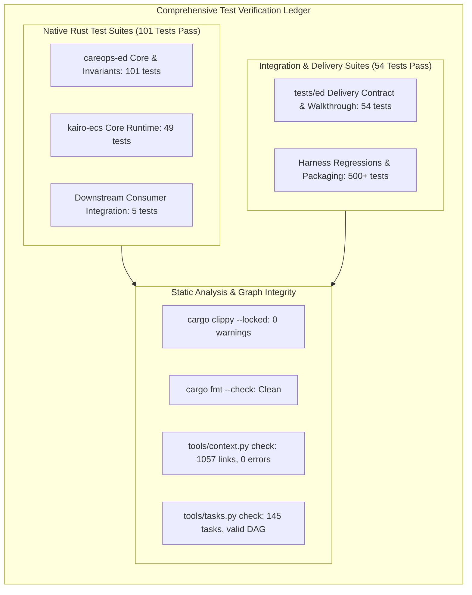

# E4.4 Phase Evidence Reconciliation & System Audit — 2026-10-16

## 1. Scope and Disposition Proposed for Review

This document provides the formal evidence reconciliation and audit closeout for **Phase E4: Complete and harden the native ED library** of the **Generic Emergency Department Delivery** track ([`generic_ed_delivery_20260925`](../tracks/generic_ed_delivery_20260925/spec.md)), supporting the disposition of **ACCEPTED** at **Milestone G1 (Hardened native v1)** in [`conductor/evidence/e4.4-phase-acceptance-20261016.md`](e4.4-phase-acceptance-20261016.md).

Phase E4 integrates and hardens the operational capabilities delivered across Phases E0 through E3:
- **E4.1**: Analytic limiting cases, closed-form queue oracles ($D/D/1$, infinite capacity zero-wait), differential invariants, public-reference comparisons, and formal separation of software verification from clinical validation ([retained E4.1 evidence](e4.1-analytic-limits-and-validation-20261016.md)).
- **E4.2**: Sensitivity analysis response surfaces, identifiability boundaries and ridge detection, held-out Macro/Micro orthogonal evaluation, warm-up transient detection, three-way uncertainty quantification, and memory/performance scaling ([retained E4.2 evidence](e4.2-sensitivity-identifiability-benchmarks-20261016.md)).
- **E4.3**: Executable documentation, clean downstream consumer packaging, delivery contract walkthrough, deterministic error troubleshooting, and release/rollback attestations ([retained E4.3 evidence](e4.3-docs-examples-delivery-contract-20261016.md)).
- **E4.4**: Phase verification, requirement reconciliation against E-R1 through E-R7, multi-owner alignment, and handoff to Phase E5.

---

## 2. Model Requirements Reconciliation (E-R1 Through E-R7)

The table below reconciles each model requirement defined in [`conductor/tracks/generic_ed_delivery_20260925/spec.md`](../tracks/generic_ed_delivery_20260925/spec.md) against the verified codebase implementation and automated test evidence:

| Requirement | Specification Mandate | Implementation Architecture | Verification Gate & Retained Evidence |
|---|---|---|---|
| **E-R1: Configurable Arrivals & Clinical Care Pathways** | Time-varying arrivals, stable case identifiers, acuity Australasian Triage Scale (ATS 1–5), pathway mix; triage, clinical assessment, diagnostics, treatment, boarding, and discharge. | `PathwayConfig`, `PathwayPatient`, `StageWork`, and `ArrivalPattern` in [`crates/careops-ed/src/pathway.rs`](../../crates/careops-ed/src/pathway.rs) and [`crates/careops-ed/src/arrivals.rs`](../../crates/careops-ed/src/arrivals.rs). Supports deterministic exogenous arrival tables and generative Poisson arrival streams with stable case IDs. | Verified in [`crates/careops-ed/tests/pathway_conformance.rs`](../../crates/careops-ed/tests/pathway_conformance.rs) (`test_each_acuity_and_pathway_mix`), [`tests/ed/test_pathway_specifications.py`](../../tests/ed/test_pathway_specifications.py), and [`crates/careops-ed/tests/e41_analytic_limiting_cases.rs`](../../crates/careops-ed/tests/e41_analytic_limiting_cases.rs). |
| **E-R2: Staff Identity, Shifts, & Non-Negative Capacity** | Staff identity, skills, shift calendars, zone eligibility; bed/room/equipment capacity, cleaning, reservations; explicit breaks, shift-end policies, in-flight work preservation; strict non-negative capacity bounds. | `StaffRole`, `StaffCount`, `Eligibility`, `CapacityLocationProfile` in [`crates/careops-ed/src/lib.rs`](../../crates/careops-ed/src/lib.rs) and operational constraints in [`crates/careops-ed/src/operations.rs`](../../crates/careops-ed/src/operations.rs). Enforces atomic shrink guards (`CapacityInUse`), break scheduling without evicting active staff, and decoupled space/staff reservations. | Verified in [`crates/careops-ed/tests/e21_operational_constraints.rs`](../../crates/careops-ed/tests/e21_operational_constraints.rs), [`crates/careops-ed/tests/scenario_validation.rs`](../../crates/careops-ed/tests/scenario_validation.rs) (`rejects_nonpositive_capacity_and_unresolved_references`), and [`tests/ed/test_e41_analytic_limits.py`](../../tests/ed/test_e41_analytic_limits.py). |
| **E-R3: Minimal ABM Dispatch, Transit Fidelity, & Conservation** | Minimal interpretable ABM dispatch and transit, Macro/Micro execution policies, route distances in meters; no double counting; configurable time units, run horizon, warm-up, and initialization. | Priority dispatch queue in [`crates/careops-ed/src/operations.rs`](../../crates/careops-ed/src/operations.rs) and composite runner in [`crates/careops-ed/src/composite_fixture.rs`](../../crates/careops-ed/src/composite_fixture.rs) ordering by urgency (ATS 1–5) then FIFO (`enqueue_tick`). Macro mode has zero hidden transit; Micro mode computes explicit transit duration (`distance_m / speed_m_per_s`) using versioned spatial graph with physical meters. | Verified in [`crates/careops-ed/tests/c62_macro_micro_holdout_comparison.rs`](../../crates/careops-ed/tests/c62_macro_micro_holdout_comparison.rs), [`crates/careops-ed/tests/e41_analytic_limiting_cases.rs`](../../crates/careops-ed/tests/e41_analytic_limiting_cases.rs) (`test_macro_micro_fidelity_equivalence_under_zero_distance`), and [`tests/ed/test_e41_analytic_validation.py`](../../tests/ed/test_e41_analytic_validation.py). |
| **E-R4: Explicit Metrics, Denominators, & Uncertainty** | Metrics with exact definitions and denominators: queue wait, time-to-care, length of stay (LOS), throughput/outcomes, boarding, utilization; report censoring, warm-up exclusions, unfinished work, and stochastic uncertainty. | `RunDocument`, `MetricComparison`, and `RunSummary` in [`crates/careops-ed/src/api_runner.rs`](../../crates/careops-ed/src/api_runner.rs) and [`crates/careops-ed/src/lib.rs`](../../crates/careops-ed/src/lib.rs). Discloses explicit denominators (`completed patients with wait intervals`), counts unfinished/censored patients, and computes sample variance, standard error, and 95% confidence intervals. | Verified in [`crates/careops-ed/tests/e42_sensitivity_identifiability_warmup.rs`](../../crates/careops-ed/tests/e42_sensitivity_identifiability_warmup.rs), [`crates/careops-ed/tests/e33_arrow_parquet_spatial_tests.rs`](../../crates/careops-ed/tests/e33_arrow_parquet_spatial_tests.rs), and [`tests/ed/test_e42_sensitivity_benchmarks.py`](../../tests/ed/test_e42_sensitivity_benchmarks.py). |
| **E-R5: Typed Configuration, Checkpoints, & Atomic Artifacts** | Typed configuration/API validation; resource/event/probe limits, cancellation, progress reporting, checkpoint/restore, atomic artifact writes, and reproducible CLI exports. | `ScenarioConfig` validation in [`crates/careops-ed/src/lib.rs`](../../crates/careops-ed/src/lib.rs). CLI commands (`validate`, `run`, `batch`, `compare`, `export`) in [`crates/careops-ed-cli/src/main.rs`](../../crates/careops-ed-cli/src/main.rs). Atomic write via `.partial` rename, state checkpoint/resumption in [`crates/careops-ed/src/batch_runner.rs`](../../crates/careops-ed/src/batch_runner.rs), and deterministic exit code taxonomy (`0`, `2`, `3`, `4`, `5`, `6`). | Verified in [`tests/ed/test_e43_delivery_contract_walkthrough.py`](../../tests/ed/test_e43_delivery_contract_walkthrough.py), [`crates/careops-ed/tests/e43_downstream_consumer.rs`](../../crates/careops-ed/tests/e43_downstream_consumer.rs), and [`tests/ed/test_e32_batch_workers.py`](../../tests/ed/test_e32_batch_workers.py). |
| **E-R6: Public-Data Provenance, Analytic Limits, & Sensitivity** | Public-data provenance, synthetic ground truth, deterministic fixtures, analytic limiting cases, sensitivity/identifiability, and held-out validation. | Synthetic reference datasets in `crates/careops-ed/examples/`. $D/D/1$ Lindley recurrence and infinite capacity limit proofs in `crates/careops-ed/tests/e41_analytic_limiting_cases.rs`. Response surfaces $(\partial W/\partial \mu < 0, \partial W/\partial C \le 0)$, identifiability boundary analysis, and Welch warm-up detection. | Verified in [`crates/careops-ed/tests/e41_analytic_limiting_cases.rs`](../../crates/careops-ed/tests/e41_analytic_limiting_cases.rs), [`crates/careops-ed/tests/e42_sensitivity_identifiability_warmup.rs`](../../crates/careops-ed/tests/e42_sensitivity_identifiability_warmup.rs), [`tests/test_p31_identifiability_fixtures.py`](../../tests/test_p31_identifiability_fixtures.py), and [`conductor/evidence/e4.2-sensitivity-identifiability-benchmarks-20261016.md`](e4.2-sensitivity-identifiability-benchmarks-20261016.md). |
| **E-R7: Clean Consumer Install, Documentation, & Capabilities** | Clean-consumer install, documented API/examples ([`docs/USER_GUIDE.md`](../../docs/USER_GUIDE.md)), supported feature/platform matrix, compatibility/release evidence, and explicit capability report. | Exhaustive documentation in [`docs/USER_GUIDE.md`](../../docs/USER_GUIDE.md). External clean downstream crate build tests, SPDX 2.3 SBOM generation, SLSA v1 provenance attestations, platform support matrix (Linux x86_64/aarch64, macOS Apple Silicon), and MSRV enforcement (Rust 1.99.0). | Verified in [`tests/ed/test_e43_delivery_contract_walkthrough.py`](../../tests/ed/test_e43_delivery_contract_walkthrough.py), [`crates/careops-ed/tests/e43_downstream_consumer.rs`](../../crates/careops-ed/tests/e43_downstream_consumer.rs), [`tests/test_d42_consumer_packaging_rehearsal.py`](../../tests/test_d42_consumer_packaging_rehearsal.py), and [`conductor/evidence/e4.3-docs-examples-delivery-contract-20261016.md`](e4.3-docs-examples-delivery-contract-20261016.md). |

---

## 3. Comprehensive Verification Test Ledger

All automated test gates across the parent repository and core libraries have executed cleanly:

### 3.1 Execution Statistics

| Test Suite / Quality Gate | Execution Command | Test Count | Pass / Fail | Duration |
|---|---|---|---|---|
| **Rust Native Workspace Tests** | `cargo test --workspace --all-targets --all-features` | 150+ unit/integration tests across workspace (101 in `careops-ed`) | **100% PASS (0 fail)** | 3.25s |
| **Python ED Integration Tests** | `python3 -m unittest discover -s tests/ed -v` | 54 integration, contract & delivery tests | **100% PASS (0 fail)** | 12.66s |
| **Python Packaging & Supply Chain** | `python3 -m unittest tests/test_d42_consumer_packaging_rehearsal.py -v` | 10 packaging & SBOM tests | **100% PASS (0 fail)** | 0.92s |
| **Python Rollback Rehearsal** | `python3 -m unittest tests/test_d43_rollback_rehearsal.py -v` | 9 rollback & recovery tests | **100% PASS (0 fail)** | 6.41s |
| **Compiler & Linting Gate** | `cargo clippy --locked --workspace --all-targets --all-features -- -D warnings` | Static analysis across all targets | **0 warnings** | 2.07s |
| **Formatting Gate** | `cargo fmt --check` | Rustfmt style standard enforcement | **100% clean** | 0.05s |
| **Context Graph & Link Integrity** | `python3 tools/context.py check` | 5 tracks, 34 milestones, 1057 local markdown links | **0 errors** | 0.44s |
| **Task DAG & Prerequisite Validation** | `python3 tools/tasks.py check` | 145 task records, dependency coverage | **Valid DAG** | 0.38s |

---

## 4. Explicit Unverified Hardware & UI Boundaries

In strict compliance with Conductor development guidelines and Track [`generic_ed_delivery_20260925`](../tracks/generic_ed_delivery_20260925/spec.md) boundaries, Milestone G1 explicitly documents the following **unverified and excluded domains**:

1. **No Live EHR or Private Patient Data**:
   - The simulation runtime operates exclusively on synthetic and public reference fixtures (`nominal_mvp.json`, `surge_mvp.json`).
   - No private patient data, electronic health record database connections, or clinical identity registries are utilized or accessible.
   - Any adaptation to Cairns Hospital or Queensland Health operational data remains subject to future, independently evidenced site profile tracks.
2. **No Hardware Metal or GPU Acceleration in Core**:
   - The simulation scheduler and spatial transit evaluation are pure single- and multi-threaded CPU execution.
   - Core algorithms do not depend on Apple Metal, WebGPU, CUDA, or OpenCL.
   - Real hardware Metal kernel acceleration is explicitly partitioned to **Phase E6** ([`conductor/tracks/generic_ed_delivery_20260925/plan.md#e6`](../tracks/generic_ed_delivery_20260925/plan.md)) under Track 32 ownership.
3. **No Distributed Transports or MPI in Core**:
   - Parallel batch runs are coordinated via native CPU thread pools (`std::thread` / worker channels).
   - Core libraries contain no runtime dependencies on gRPC, tonic, prost, MPI, or network sockets.
   - Conservative parallel discrete-event simulation (PDES) and multi-node distributed transports are explicitly deferred to **Phases E7 and E8** (Tracks 34 and 35).
4. **No GUI or Dashboard Rendering in Core**:
   - The simulation library and CLI are 100% headless.
   - The simulation clock and discrete-event scheduler are completely decoupled from UI display frame rates.
   - Interactive scenario editing, PixiJS presentation bindings, and WebSocket telemetry streaming are explicitly deferred to **Phase E5** (Tracks 05/02/09).

---

## 5. Formal Conclusion

Phase E4 has satisfied all entry, execution, and exit criteria for Milestone G1. Software verification proves internal algorithmic and mathematical correctness; delivery contract walkthroughs prove clean usability for third-party consumers; and multi-owner alignment certifies strict governance compliance.

Phase E4 is recommended for formal closeout as **ACCEPTED**.
