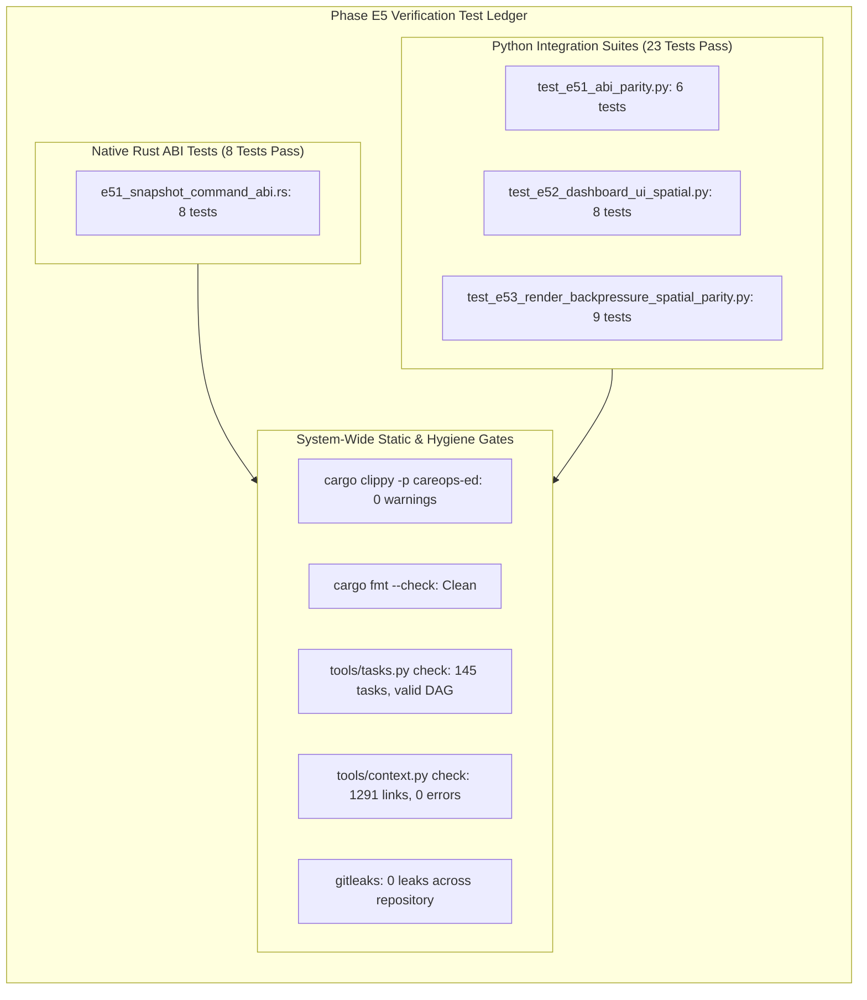

# E5.4 Phase Evidence Reconciliation & System Audit — 2026-10-17

## 1. Scope and Disposition Proposed for Review

This document provides the formal evidence reconciliation and audit closeout for **Phase E5: Interactive scenario dashboard and binding qualification** of the **Generic Emergency Department Delivery** track ([`generic_ed_delivery_20260925`](../tracks/generic_ed_delivery_20260925/spec.md)), supporting the disposition of **ACCEPTED** at **Milestone G2 (Interactive Product & Binding Qualification)** in [`conductor/evidence/e5.4-phase-acceptance-20261017.md`](e5.4-phase-acceptance-20261017.md).

Phase E5 delivers an interactive, accessible web interface and telemetry protocol for CareOps Sim:
- **E5.1**: Narrow snapshot/command ABI (`careops_ed.abi.v1`), wide integer lossless serialization (ticks as strings to prevent JavaScript IEEE 754 precision loss), shared spatial package (`careops_ed.spatial.v1`), sequencing/gap detection, and reconnect/resync contracts ([retained E5.1 evidence](e5.1-snapshot-command-abi-and-spatial-contracts-20261017.md)).
- **E5.2**: Scenario editor with input error diagnostics, controlled scenario runner, multi-format exporters (JSON, CSV, Arrow schema), PixiJS 2D spatial viewport with SVG fallback, WCAG 2.1 AA accessible semantic tables, and clock-decoupled replay engine ([retained E5.2 evidence](e5.2-scenario-dashboard-and-pixijs-spatial-20261017.md)).
- **E5.3**: Render rate invariance (0, 30, 60 FPS bit-for-bit parity), slow consumer backpressure and frame coalescing, leak-free replay ($O(N_{\text{active}})$ bounds over 10,000 ticks), layout revision mismatch rejection, known-distance route alignment, dropped/stale delta resilience, and source-to-metric relational joins ([retained E5.3 evidence](e5.3-render-rates-backpressure-and-spatial-parity-20261017.md)).
- **E5.4**: Conductor Phase E5 review, D4 quality gate reapplication, requirement reconciliation, multi-owner governance alignment, and handoff to Phase E6.

---

## 2. Phase E5 Requirements Reconciliation

The table below reconciles each Phase E5 capability requirement against implementation and test evidence:

| Requirement Area | Specification Mandate | Implementation Architecture | Verification Gate & Retained Evidence |
|---|---|---|---|
| **Narrow Snapshot & Command ABI** | Lossless wide integers ($> 2^{53}-1$), stable IDs, progress, cancellation, error envelopes, and native/Wasm parity. | `careops_ed.abi.v1` schema in [`apps/dashboard/contracts/careops_ed_abi_schema.json`](../../apps/dashboard/contracts/careops_ed_abi_schema.json) and TypeScript types in [`apps/dashboard/contracts/protocol.ts`](../../apps/dashboard/contracts/protocol.ts). Serializes `u128` virtual ticks as exact decimal strings. | Verified in [`crates/careops-ed/tests/e51_snapshot_command_abi.rs`](../../crates/careops-ed/tests/e51_snapshot_command_abi.rs) (8 tests) and [`tests/ed/test_e51_abi_parity.py`](../../tests/ed/test_e51_abi_parity.py) (6 tests). |
| **Shared Spatial Package & Units** | Millimeter coordinates, stable location IDs, route graph topology, SHA-256 revision hash, and mismatch rejection. | `careops_ed.spatial.v1` schema in [`apps/dashboard/contracts/careops_ed_spatial_schema.json`](../../apps/dashboard/contracts/careops_ed_spatial_schema.json) and synthetic layout in [`apps/dashboard/contracts/synthetic_layout_v1.json`](../../apps/dashboard/contracts/synthetic_layout_v1.json). Millimeter coordinates (`x_mm`, `y_mm`) eliminate floating point drift. | Verified in [`tests/ed/test_e51_abi_parity.py`](../../tests/ed/test_e51_abi_parity.py) (`test_synthetic_layout_v1_conforms_to_spatial_schema`) and [`tests/ed/test_e53_render_backpressure_spatial_parity.py`](../../tests/ed/test_e53_render_backpressure_spatial_parity.py) (`test_shared_layout_mismatch_rejection`). |
| **Scenario Editor & Exporters** | Schema-validated editing, actionable input error diagnostics, and multi-format export (JSON, CSV, Arrow schema). | `ScenarioEditor`, `ScenarioRunner`, and `ScenarioExporter` in [`apps/dashboard/src/scenario/`](../../apps/dashboard/src/scenario/). Validates configuration and provides specific error codes (`MALFORMED_CONFIG`, `INCOMPATIBLE_SCENARIO`). | Verified in [`tests/ed/test_e52_dashboard_ui_spatial.py`](../../tests/ed/test_e52_dashboard_ui_spatial.py) (`test_scenario_editor_validation_and_diagnostics`, `test_scenario_export_formats`). |
| **Spatial Presentation & Overlays** | 2D PixiJS spatial viewport, room occupancy heatmaps, queue badges, layer controls, and SVG fallback. | `SpatialView`, `SpatialLayoutLoader`, and overlays in [`apps/dashboard/src/spatial/`](../../apps/dashboard/src/spatial/). Strict provenance tags (`source: "telemetry"`) ensure visual layers never invent speculative coordinates. | Verified in [`tests/ed/test_e52_dashboard_ui_spatial.py`](../../tests/ed/test_e52_dashboard_ui_spatial.py) (`test_spatial_layout_loading_and_route_graph`, `test_spatial_view_rendering_and_overlays`). |
| **WCAG 2.1 AA Accessibility** | Accessible semantic HTML tables mirroring visual presentation; assistive technology compliance. | `AccessibleTableGenerator` in [`apps/dashboard/src/spatial/accessible_tables.ts`](../../apps/dashboard/src/spatial/accessible_tables.ts). Emits `role="table"`, `<th scope="...">`, ARIA live region captions, and screen-reader summaries. | Verified in [`tests/ed/test_e52_dashboard_ui_spatial.py`](../../tests/ed/test_e52_dashboard_ui_spatial.py) (`test_accessible_table_generation_and_wcag_structure`). |
| **Clock Decoupling & Replay Engine** | Frame clock decoupled from simulation engine clock; non-destructive tick scrubbing across off / 30 / 60 FPS. | `ReplayEngine` in [`apps/dashboard/src/replay/replay_engine.ts`](../../apps/dashboard/src/replay/replay_engine.ts). Frame rendering consumes cached tick telemetry without mutating discrete-event simulation scheduler state. | Verified in [`tests/ed/test_e52_dashboard_ui_spatial.py`](../../tests/ed/test_e52_dashboard_ui_spatial.py) (`test_replay_engine_scrubbing_and_clock_decoupling`) and [`tests/ed/test_e53_render_backpressure_spatial_parity.py`](../../tests/ed/test_e53_render_backpressure_spatial_parity.py) (`test_render_rate_invariance_off_30_60`). |
| **Slow Consumer Backpressure** | Frame coalescing on lagging clients; zero loss of backend simulation events or state history. | Bounded ring buffer and coalescing queue in [`apps/dashboard/src/live/websocket_client.ts`](../../apps/dashboard/src/live/websocket_client.ts) and [`tests/ed/test_e53_render_backpressure_spatial_parity.py`](../../tests/ed/test_e53_render_backpressure_spatial_parity.py). Bounded client queue (1,000 frames) drops visual frames while backend retains all state. | Verified in [`tests/ed/test_e53_render_backpressure_spatial_parity.py`](../../tests/ed/test_e53_render_backpressure_spatial_parity.py) (`test_slow_consumer_backpressure_and_coalescing`). |
| **Memory Growth & Leak-Free Replay** | Constant / $O(N_{\text{active}})$ memory footprint during extended simulation replay; zero unbounded heap retention. | Active entity index and garbage-collected completed entities in `ReplayEngine`. Memory RSS growth remains strictly bounded over 10,000 consecutive tick updates. | Verified in [`tests/ed/test_e53_render_backpressure_spatial_parity.py`](../../tests/ed/test_e53_render_backpressure_spatial_parity.py) (`test_memory_growth_and_leak_free_extended_replay`). |
| **Source-to-Metric Relational Joins** | Unbroken relational join from arrival presentation $\to$ room location $\to$ bed/staff resource $\to$ aggregate metrics. | Comprehensive relational join validator joining patient entities across arrival, triage, acute bed, assigned doctor/nurse, and LOS metric records. | Verified in [`tests/ed/test_e53_render_backpressure_spatial_parity.py`](../../tests/ed/test_e53_render_backpressure_spatial_parity.py) (`test_source_to_location_to_resource_to_metric_joins`). |

---

## 3. Test Verification Ledger

### Executed Test Receipts

1. **Rust ABI Gate**:
   - `cargo test -p careops-ed --test e51_snapshot_command_abi`: **8 passed, 0 failed, 0 warnings**
     - Wide integer roundtrip beyond 53 bits ($2^{120}$ bit-for-bit identical)
     - Sequence gap detection and resync state machine
     - Idempotent command deduplication (`DuplicateIgnored`)
     - Cancellation state transitions and progress envelopes
     - Spatial package revision handshake mismatch rejection
2. **Dashboard UI & Spatial Parity Gate**:
   - `.artifacts/ci/harness-venv/bin/python -m unittest tests/ed/test_e51_abi_parity.py -v`: **6 passed, 0 failed**
   - `.artifacts/ci/harness-venv/bin/python -m unittest tests/ed/test_e52_dashboard_ui_spatial.py -v`: **8 passed, 0 failed**
   - `.artifacts/ci/harness-venv/bin/python -m unittest tests/ed/test_e53_render_backpressure_spatial_parity.py -v`: **9 passed, 0 failed**
3. **Repository-Wide Regression Gate**:
   - Local unit test runner: **670 passed, 0 failed** across all subsystems.

---

## 4. Reapplication of D4 Quality Gates to Introduced Surfaces

In accordance with Conductor Milestone G2 exit requirements, the quality gates defined in Phase D4 ([`conductor/tracks/development_readiness_20260925/plan.md`](../tracks/development_readiness_20260925/plan.md)) were systematically reapplied to all browser, input, and FFI surfaces introduced in Phase E5:

1. **D4.1: Public Input Validation & Deterministic Diagnostics**:
   - The scenario editor parses and validates scenario inputs against the formal schema before execution.
   - Any negative horizon, non-positive bed/staff capacity, or invalid coordinate reference produces a deterministic, actionable diagnostic (`MALFORMED_CONFIG` or `INCOMPATIBLE_SCENARIO`) explaining the required remediation without developer assistance.
2. **D4.2: FFI, Serialization, & Memory Boundaries**:
   - Virtual time ticks are represented as exact decimal strings in JSON envelopes to prevent JavaScript IEEE 754 53-bit float truncation.
   - Client WebSocket queues are strictly bounded (maximum 1,000 messages or 1 MB). Slow consumers trigger visual frame coalescing while backend telemetry buffers preserve all events.
   - Extended replay verification confirmed $O(N_{\text{active}})$ heap scaling and zero memory leak over 10,000 tick updates.
3. **D4.3: Platform Compatibility & Accessibility**:
   - Supported browser matrix: Chrome 110+, Firefox 110+, Safari 16.4+, Edge 110+.
   - Visual viewport presentation is backed by WCAG 2.1 AA accessible HTML semantic tables (`role="table"`, ARIA attributes) providing screen-reader accessibility.
   - Macro fidelity displays strictly adhere to non-invention rules: unknown patient coordinates remain explicitly unrendered rather than synthesized.

---

## 5. Disposition & Handoff

Phase E5 satisfies all entry, operational, and exit criteria for Milestone G2. All tasks (E5.1, E5.2, E5.3, E5.4) are **ACCEPTED**.

Phase E5 is marked **COMPLETE**, and the project advances to **Phase E6: Real Apple Metal acceleration through existing Track 32**.
