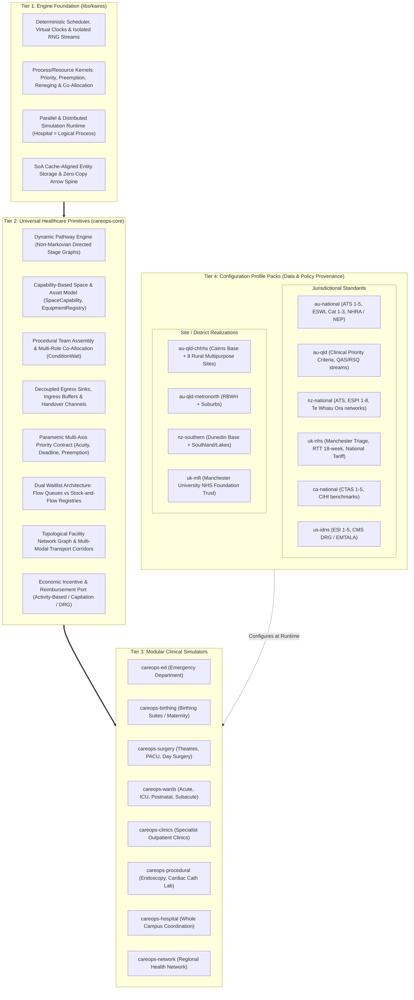

# Product Vision, Mission & Architecture: CareOps Sim

## 1. Vision, Mission & Purpose

### Vision
To provide the global standard for high-performance, bottom-up simulation of complex healthcare systems, capable of modelling operational dynamics from micro-level clinical decisions to whole-of-hospital campus flow and regional multi-hospital health networks.

### Mission
Empower health service executives, clinical directors, operations leads, and health system planners with an evidence-grounded, deterministic simulation platform built natively in Rust on the [Kairos](../libs/kairos) ECS/DES/ABM engine. CareOps Sim enables risk-free experimentation with capacity changes, workforce models, demand surges, inter-facility transport logistics, and health economic policies.

### Core Philosophy: Strict Universal Abstraction
Cairns and Hinterland Hospital and Health Service (CHHHS) serves as our primary empirical baseline, but **the platform is strictly domain-neutral and universally abstractable**. 
- The simulation engine and clinical crates (`careops-core`, `careops-ed`, `careops-birthing`, `careops-surgery`, `careops-wards`, `careops-clinics`, `careops-hospital`, `careops-network`) contain **zero hardcoded regional names, facility identifiers, or jurisdictional acronyms**.
- All jurisdictional conventions (e.g. Australian ATS/NHRA, UK NHS MTS/RTT, New Zealand Te Whatu Ora ESPI, Canadian CTAS, US ESI/DRG) and physical site topologies (e.g. CHHHS, Metro North, Southern NZ, NHS Trust networks) are configured exclusively via **layered, versioned Profile Packs**.

---

## 2. The 4-Tier Abstraction Architecture

---

## 3. Operational Scales

The platform models health system behavior across three interconnected scales:

### Scale 1: Micro / Clinical Unit Simulators
- **`careops-ed`**: Emergency department arrivals, triage, clinical assessment, resuscitation, treatment, diagnostics, and admission boarding.
- **`careops-birthing`**: Maternal labor progression (latent, active, second stage delivery, third stage recovery), dynamic neonate spawning and linked mother-infant tracking, capability-based LDR suites, 1:1 midwifery staffing, and acute emergency caesarean preemption.
- **`careops-surgery`**: Operating theatre scheduling, emergency acute sessions (CEPOD), PACU recovery, day surgery pathways, surgical tray turnover, and instrument sterilization.
- **`careops-wards`**: Inpatient acute medical/surgical wards, intensive care (ICU/HDU), postnatal accommodation, subacute rehabilitation, and infection-control isolation beds.
- **`careops-clinics`**: Specialist outpatient consultation sessions, referral triage, appointment templates, and follow-up review cycles.
- **`careops-procedural`**: Short-stay procedural units (endoscopy, interventional radiology, cardiac catheterization labs).
- **`careops-waitlist`**: Dual waitlist management (flow queues for physically present patients vs stock-and-flow registries for outpatient/surgical queues).

### Scale 2: Meso / Whole-of-Hospital Campus Orchestration (`careops-hospital`)
- **Central Patient Flow & Bed Placement Operations**: Hospital-wide bed allocation, bed-cleaning dispatch, acute overflow surge zones, and proactive bed-block mitigation.
- **Transversal Diagnostic Services**: Central medical imaging (CT, MRI, ultrasound, general X-ray) and pathology turnaround times shared across all clinical units.
- **Workforce & Rapid Response**: Central transporter/orderly pools, multi-disciplinary shift rosters, shift handovers, on-call specialist recall, and rapid response / Medical Emergency Teams (MET).

### Scale 3: Macro / Regional Health Network (`careops-network`)
- **Topological Facility Graph**: Connecting tertiary base referral hospitals, secondary regional centres, rural multipurpose health services, and community ambulatory clinics.
- **Distributed Simulation Execution**: Utilizing Kairos native Parallel Discrete Event Simulation (`kairo-ecs-pdes`), each hospital campus executes as an autonomous Logical Process (LP), enabling massive parallel scaling across multi-core and cluster nodes.
- **Multi-Modal Transport Corridors**: Coordinated road ambulances, non-acute patient transport vans, rotary-wing rescue helicopters, fixed-wing air ambulances, rideshares, and private vehicles.
- **Primary, Private & Aged Care Continuum**: Seamless interfaces with General Practice, private hospital outsourcing/escalation, Medicare Urgent Care Clinics, and Residential Aged Care Facilities.
- **Health Economics & Policy**: Connecting operational decisions to jurisdictional funding mechanisms via **`nhra_gt`** (Australian NHRA activity-based funding, NEP, NWAU, and funding caps) and Kairos game-theoretic equilibrium solvers.

---

## 4. Key Cross-Cutting Architectural Frameworks

- **Universal Triage & Priority**: Parametric contract mapping across Australasian ATS, Canadian CTAS, UK Manchester Triage, US ESI, acute surgical categories (Cat 1–4), elective surgery waitlist benchmarks (Cat 1–3), and specialist outpatient criteria (Cat 1–3). Detailed in [Universal Triage & Priority Framework](design/universal-triage-priority-framework.md).
- **Transport Fleet, Retrieval Streams & Boundary Flows**: Operational modeling of road/air fleets, EMT/paramedic/physician crew streams, intra-district networks, neighbouring district referrals, interstate quaternary transfers, and international inflows. Detailed in [Transport, Retrieval & Interfacility Boundary Flows](design/transport-retrieval-interfacility-flow.md).
- **Community, Private & Aged Care Continuum**: Detailed modeling of private hospital partnerships, GP referrals, Urgent Care diversions, and RACF frailty inflows / delayed-discharge bed-blocking.
- **Master Milestone Sequence**: Formal delivery progression from M0 (Engine Reconciliation) to M6 (Regional Health Network). Detailed in [Product Expansion Roadmap](roadmap.md).
