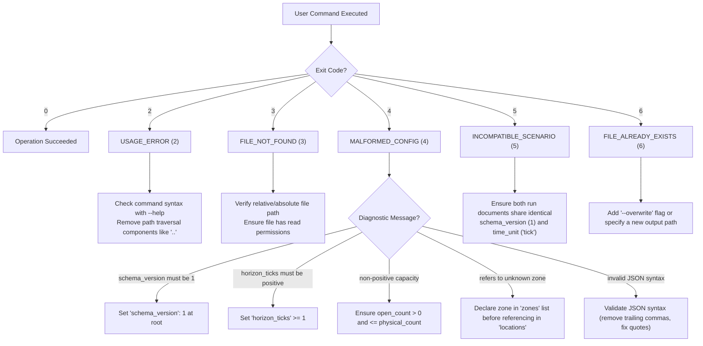

# CareOps Sim v1.0 User Guide & Delivery Qualification

From the repository root, create the required environment with `uv venv --python 3.15.1 .venv` only when `.venv` is absent. Verify it with `.venv/bin/python tools/python_runtime.py`, then use `.venv/bin/python` for the commands below. Do not replace an existing or in-flight environment; the guard rejects an unqualified one. Windows uses `.venv\Scripts\python.exe`.


Comprehensive guide for fresh users to install, configure, execute, compare, export, and troubleshoot the Rust-native CareOps emergency department simulation engine (`careops-ed`).

---

## Table of Contents

1. [Architectural Overview & Verification Scope](#1-architectural-overview--verification-scope)
2. [Quickstart Walkthrough](#2-quickstart-walkthrough)
   - [System Prerequisites](#system-prerequisites)
   - [Building the Executable](#building-the-executable)
   - [CLI Command Overview](#cli-command-overview)
3. [Step-by-Step Tutorial: Operational Scenario Comparison](#3-step-by-step-tutorial-operational-scenario-comparison)
   - [Step 1: Inspecting & Validating Scenario Configurations](#step-1-inspecting--validating-scenario-configurations)
   - [Step 2: Executing the Nominal Scenario](#step-2-executing-the-nominal-scenario)
   - [Step 3: Executing the Surge Scenario](#step-3-executing-the-surge-scenario)
   - [Step 4: Comparing Operational Outcomes](#step-4-comparing-operational-outcomes)
   - [Step 5: Multi-Format Data Export](#step-5-multi-format-data-export)
4. [Intentional Input Error Troubleshooting & Decision Tree](#4-intentional-input-error-troubleshooting--decision-tree)
   - [Deterministic Exit Code Mapping](#deterministic-exit-code-mapping)
   - [Troubleshooting Decision Tree](#troubleshooting-decision-tree)
   - [Diagnosing Common Mistakes & JSON Remediation](#diagnosing-common-mistakes--json-remediation)
5. [Platform Support Matrix & Operational Boundaries](#5-platform-support-matrix--operational-boundaries)
   - [Tier 1 Supported Platforms](#tier-1-supported-platforms)
   - [Explicit Unsupported Boundaries](#explicit-unsupported-boundaries)
6. [Input & Schema Migration Policy](#6-input--schema-migration-policy)
   - [Semantic Versioning Guarantees](#semantic-versioning-guarantees)
   - [Strict Rejection of Unknown Fields](#strict-rejection-of-unknown-fields)
   - [Deprecation & Migration Path](#deprecation--migration-path)
7. [Verification & Release Evidence Checks](#7-verification--release-evidence-checks)

---

## 1. Architectural Overview & Verification Scope

CareOps Sim is a high-performance, deterministic discrete-event simulation (DES) and agent-based modeling (ABM) engine developed in Rust, powered by the Kairos / KairoECS scheduling kernel. It is designed to model emergency department (ED) patient journeys—from arrival and triage to acute treatment, diagnostics, and disposition/boarding.

> [!IMPORTANT]
> **Verification Taxonomy & Disclaimer**:
> Software verification of simulation mechanics (queueing disciplines, state invariants, fixed-seed determinism, and patient conservation laws) does **NOT** constitute clinical domain validation for any specific healthcare institution. All standard scenarios use synthetic profiles or public anonymized reference data.

---

## 2. Quickstart Walkthrough

### System Prerequisites

- **Rust Toolchain**: Rust 1.99.1 (pinned via `rust-toolchain.toml`).
- **Cargo**: Included with the Rust toolchain.
- **Python**: Python 3.10+ (required only for running regression and evidence validation tools).

### Building the Executable

Clone the repository and build the locked release binary:

```sh
# Ensure submodules are initialized
git submodule update --init --recursive

# Build the CLI executable in release mode
cargo build --locked --release --package careops-ed-cli
```

The resulting binary is located at `target/release/careops-ed`. Throughout this guide, commands are demonstrated using both `cargo run -p careops-ed-cli --` and the compiled binary `./target/release/careops-ed`.

### CLI Command Overview

The CLI binary exposes five primary commands:

```
Usage: careops-ed <command> [options]

Commands:
  validate <scenario.json>
      Validate scenario schema, parameters, resource capacity, and referential integrity.

  run <scenario.json> [options]
      Execute a single-replication simulation scenario.
      Options:
        --seed <u64>          Override pseudo-random generator seed
        --horizon <u64>       Override simulation horizon in ticks
        --output <path>       Destination file path for results
        --overwrite           Allow overwriting an existing output file
        --format <json|csv>   Output format (default: json)
        --reference <name>    Use checked-in reference scenario (nominal | constrained)

  batch <scenario.json> [options]
      Execute multi-replication experiments across independent CPU workers with checkpointing.
      Options:
        --replications <usize>  Number of replications (default: 4)
        --workers <usize>       Worker threads count (default: 2)
        --seed <u64>            Base seed for deterministic seed sequence
        --horizon <u64>         Override simulation horizon in ticks
        --output-dir <path>     Directory for checkpoint and final artifact
        --checkpoint <usize>    Checkpoint frequency in replications (default: 2)
        --resume <path>         Resume interrupted batch from checkpoint
        --export-arrow <path>   Export Arrow/Parquet bundle with denominators
        --export-spatial <path> Export spatial route traversal summaries to CSV
        --spatial-rev <string>  Spatial revision identifier

  compare <base_run.json> <candidate_run.json>
      Compare operational metrics between two simulation runs with units, denominators,
      percentage deltas, standard errors, and heuristic diagnostics.

  export <run.json> [options]
      Export run document to tabular CSV or columnar schema descriptors.
      Options:
        --format <json|csv|arrow|parquet>  Export format (default: csv)
        --output <path>                    Destination file path
        --overwrite                        Allow overwriting existing output file
```

---

## 3. Step-by-Step Tutorial: Operational Scenario Comparison

This tutorial demonstrates the delivery contract workflow: a fresh user inspects two checked-in scenarios, validates their schemas, executes the simulations, performs a controlled comparison of patient wait times and resource utilization, and exports the findings in multiple downstream formats.

### Step 1: Inspecting & Validating Scenario Configurations

CareOps Sim provides pre-configured synthetic scenario profiles in `crates/careops-ed/examples/`:
- [nominal_mvp.json](file:///Users/doughnut/.codex/worktrees/c2-transit-draw-oracle/careops-sim/crates/careops-ed/examples/nominal_mvp.json): 5 arrivals, 2 acute treatment bays, adequate nursing staff.
- [surge_mvp.json](file:///Users/doughnut/.codex/worktrees/c2-transit-draw-oracle/careops-sim/crates/careops-ed/examples/surge_mvp.json): 10 high-acuity presentations arriving under constrained capacity (acute capacity reduced from 2 to 1 bay, nursing staff reduced to 2).

Validate both scenarios to confirm schema conformity:

```sh
# Validate nominal scenario
cargo run -p careops-ed-cli -- validate crates/careops-ed/examples/nominal_mvp.json

# Validate surge scenario
cargo run -p careops-ed-cli -- validate crates/careops-ed/examples/surge_mvp.json
```

**Expected Output:**
```
valid scenario 'nominal-ed-mvp' (schema v1, 20 ticks tick, 5 physical / 5 open beds, 5 patients)
valid scenario 'surge-ed-mvp' (schema v1, 25 ticks tick, 5 physical / 4 open beds, 10 patients)
```

### Step 2: Executing the Nominal Scenario

Run the nominal baseline scenario and write the resulting run document to `outputs/nominal_run.json`:

```sh
mkdir -p outputs
cargo run -p careops-ed-cli -- run crates/careops-ed/examples/nominal_mvp.json \
  --output outputs/nominal_run.json \
  --overwrite
```

**Output Receipt:**
```
run completed successfully; wrote output to 'outputs/nominal_run.json'
```

The generated document includes an SHA-256 provenance manifest, software verification taxonomy, and per-patient interval records.

### Step 3: Executing the Surge Scenario

Run the surge scenario under constrained capacity:

```sh
cargo run -p careops-ed-cli -- run crates/careops-ed/examples/surge_mvp.json \
  --output outputs/surge_run.json \
  --overwrite
```

**Output Receipt:**
```
run completed successfully; wrote output to 'outputs/surge_run.json'
```

### Step 4: Comparing Operational Outcomes

Compare the two run artifacts using the `compare` command:

```sh
cargo run -p careops-ed-cli -- compare outputs/nominal_run.json outputs/surge_run.json
```

**Comparison Output:**
```json
{
  "base_scenario_id": "nominal-ed-mvp",
  "candidate_scenario_id": "surge-ed-mvp",
  "time_unit": "tick",
  "metrics": [
    {
      "metric_name": "arrivals",
      "unit": "patient",
      "denominator_description": "total presentation count",
      "base_value": 5.0,
      "candidate_value": 10.0,
      "delta": 5.0,
      "percent_change": 100.0,
      "base_se": null,
      "candidate_se": null
    },
    {
      "metric_name": "completed",
      "unit": "patient",
      "denominator_description": "arrivals",
      "base_value": 5.0,
      "candidate_value": 8.0,
      "delta": 3.0,
      "percent_change": 60.0,
      "base_se": null,
      "candidate_se": null
    },
    {
      "metric_name": "unfinished",
      "unit": "patient",
      "denominator_description": "arrivals",
      "base_value": 0.0,
      "candidate_value": 2.0,
      "delta": 2.0,
      "percent_change": null,
      "base_se": null,
      "candidate_se": null
    },
    {
      "metric_name": "mean_wait",
      "unit": "tick",
      "denominator_description": "completed patients with wait intervals",
      "base_value": 0.4,
      "candidate_value": 9.11,
      "delta": 8.71,
      "percent_change": 2177.78,
      "base_se": 0.24,
      "candidate_se": 1.80
    },
    {
      "metric_name": "mean_elapsed",
      "unit": "tick",
      "denominator_description": "completed patients with elapsed intervals",
      "base_value": 3.4,
      "candidate_value": 11.12,
      "delta": 7.72,
      "percent_change": 227.21,
      "base_se": 0.40,
      "candidate_se": 1.66
    },
    {
      "metric_name": "peak_occupancy",
      "unit": "bay",
      "denominator_description": "peak concurrent bay occupancy",
      "base_value": 2.0,
      "candidate_value": 1.0,
      "delta": -1.0,
      "percent_change": -50.0,
      "base_se": null,
      "candidate_se": null
    }
  ],
  "diagnostics": [
    "Constrained capacity or demand increased mean wait by 8.71 tick",
    "Unfinished / censored presentations increased by 2"
  ],
  "validation_taxonomy": {
    "verification_scope": "software_verification",
    "validation_scope": "none",
    "provenance_class": "synthetic",
    "disclaimer": "Software verification of simulation mechanics (queueing, state invariants, determinism) does NOT constitute clinical domain validation for any healthcare site."
  }
}
```

**Key Operational Findings**:
- **Mean Wait Time**: Surges by +2,177.8% (from 0.4 ticks to 9.11 ticks) due to acute bay bottlenecking.
- **Queue Saturation & Censoring**: 2 patients remain unfinished at the horizon tick, demonstrating realistic queue spillover under surge conditions.
- **Conservation Invariant**: Patient conservation strictly holds: `arrivals (10) = completed (8) + unfinished (2)`.

### Step 5: Multi-Format Data Export

Export the simulation results for tabular reporting, Arrow analytics, or Parquet data lakes:

```sh
# 1. Export patient-level event traces to CSV
cargo run -p careops-ed-cli -- export outputs/surge_run.json \
  --format csv \
  --output outputs/surge_patients.csv \
  --overwrite

# 2. Export Arrow schema definition with data types and unit metadata
cargo run -p careops-ed-cli -- export outputs/surge_run.json \
  --format arrow \
  --output outputs/arrow_schema.json \
  --overwrite

# 3. Export Parquet schema DDL for columnar storage
cargo run -p careops-ed-cli -- export outputs/surge_run.json \
  --format parquet \
  --output outputs/table_schema.parquet.sql \
  --overwrite
```

Inspect the generated CSV:
```sh
head -n 5 outputs/surge_patients.csv
```
```csv
patient_id,arrival_tick,start_tick,completion_tick,work_ticks,wait_ticks,elapsed_ticks,status
patient-001,1,1,4,3,0,3,completed
patient-002,1,4,8,4,3,7,completed
patient-003,2,8,11,3,6,9,completed
patient-004,3,11,14,3,8,11,completed
```

---

## 4. Intentional Input Error Troubleshooting & Decision Tree

CareOps Sim enforces strict fail-closed validation. When an invalid input is supplied, the CLI prints an actionable diagnostic to `stderr` and exits with a deterministic exit code.

### Deterministic Exit Code Mapping

| Exit Code | Identifier | Trigger Condition | Primary Remediation |
|---|---|---|---|
| **0** | `SUCCESS` | Operation completed cleanly | None required |
| **2** | `USAGE_ERROR` | Missing arguments, unknown flags, path traversal (`..`) | Check CLI syntax with `--help` |
| **3** | `FILE_NOT_FOUND` | Scenario or run document file does not exist or unreadable | Check file path and read permissions |
| **4** | `MALFORMED_CONFIG` | Schema version mismatch, invalid JSON, non-positive horizon, missing zones/locations, capacity bounds violation | Edit scenario JSON (see troubleshooting guide below) |
| **5** | `INCOMPATIBLE_SCENARIO` | Comparing runs with mismatched schema versions or time units | Align `schema_version` and `time_unit` across both runs |
| **6** | `FILE_ALREADY_EXISTS` | Destination file exists and `--overwrite` was not passed | Supply `--overwrite` or choose a distinct output path |
| **7** | `OUTPUT_WRITE_FAILED` | Disk full or directory write permission denied | Check disk storage and filesystem permissions |
| **8** | `SIMULATION_FAILED` | Internal scheduling or state invariant violation | Verify scenario event parameters; inspect log |
| **9** | `INTERRUPTED` | Execution interrupted via SIGINT/SIGTERM or cancelled | Re-run batch with `--resume` from checkpoint |

### Troubleshooting Decision Tree



### Diagnosing Common Mistakes & JSON Remediation

All input issues can be resolved purely by editing the input JSON configuration without modifying any Rust source code or requiring developer intervention.

#### Mistake 1: Non-positive or Negative Horizon (`MALFORMED_CONFIG`)

- **Trigger**: Running scenario with `"horizon_ticks": 0`.
- **Diagnostic Output**:
  ```
  careops-ed: [MALFORMED_CONFIG (4)] invalid scenario: horizon_ticks must be positive
  ```
- **Remediation**:
  Open the scenario JSON and set `horizon_ticks` to a positive integer:
  ```json
  "horizon_ticks": 20
  ```

#### Mistake 2: Missing or Incompatible Schema Version (`MALFORMED_CONFIG`)

- **Trigger**: `"schema_version": 2` or `"schema_version": 0`.
- **Diagnostic Output**:
  ```
  careops-ed: [MALFORMED_CONFIG (4)] invalid scenario: schema_version must be 1
  ```
- **Remediation**:
  Ensure the root schema version is set to `1`:
  ```json
  "schema_version": 1
  ```

#### Mistake 3: Zero or Inconsistent Capacity Counts (`MALFORMED_CONFIG`)

- **Trigger**: Setting `"open_count": 0` or `"open_count": 5` when `"physical_count": 2`.
- **Diagnostic Output**:
  ```
  careops-ed: [MALFORMED_CONFIG (4)] invalid scenario: resource 'res.acute' open_count exceeds physical_count
  ```
- **Remediation**:
  Ensure resource counts obey the invariant `0 < staffed_count <= open_count <= physical_count`:
  ```json
  "physical_count": 2,
  "open_count": 2,
  "staffed_count": 2
  ```

#### Mistake 4: Location Referring to an Unknown Zone (`MALFORMED_CONFIG`)

- **Trigger**: `"zone_id": "zone.unknown"` in a location definition when `"zone.unknown"` was not defined in `"zones"`.
- **Diagnostic Output**:
  ```
  careops-ed: [MALFORMED_CONFIG (4)] invalid scenario: location 'loc.acute.1' refers to unknown zone 'zone.unknown'
  ```
- **Remediation**:
  Add the zone to the `zones` array before referencing it:
  ```json
  "zones": [
    {"zone_id": "zone.unknown", "name": "Dedicated Expansion Zone"}
  ]
  ```

#### Mistake 5: Invalid JSON Syntax / Trailing Commas (`MALFORMED_CONFIG`)

- **Trigger**: Syntax errors, unclosed brackets, or trailing commas in the scenario file.
- **Diagnostic Output**:
  ```
  careops-ed: [MALFORMED_CONFIG (4)] invalid scenario: trailing comma at line 14 column 5
  ```
- **Remediation**:
  Use a JSON linter (e.g., `jq . <scenario.json>`) to detect syntax mistakes and remove trailing commas.

#### Mistake 6: Incompatible Scenarios in `compare` (`INCOMPATIBLE_SCENARIO`)

- **Trigger**: Running `careops-ed compare` on runs generated with different time units (e.g., `tick` vs `minute`).
- **Diagnostic Output**:
  ```
  careops-ed: [INCOMPATIBLE_SCENARIO (5)] incompatible time units: base uses 'tick', candidate uses 'minute'
  ```
- **Remediation**:
  Re-run both simulations with consistent time units (`"time_unit": "tick"`).

#### Mistake 7: Output Collision without Overwrite (`FILE_ALREADY_EXISTS`)

- **Trigger**: Running `careops-ed run scenario.json --output results.json` when `results.json` already exists.
- **Diagnostic Output**:
  ```
  careops-ed: [FILE_ALREADY_EXISTS (6)] output file 'results.json' already exists; use --overwrite to replace it
  ```
- **Remediation**:
  Pass `--overwrite` to authorize replacing the file, or specify an alternative path.

---

## 5. Platform Support Matrix & Operational Boundaries

### Tier 1 Supported Platforms

The following table records earlier Rust 1.99.0 platform qualification. The current exact pin is 1.99.1; qualification of this source revision requires its own hosted checks:

| Platform Triple | Operating System | Architecture | Toolchain | Verification Status |
|---|---|---|---|---|
| `x86_64-unknown-linux-gnu` | Linux (Ubuntu 22.04 LTS+, kernel 5.15+) | x86_64 (64-bit AMD/Intel) | Rust 1.99.0 | Tier 1 (CI Verified) |
| `aarch64-apple-darwin` | macOS 14 Sonoma+ / macOS 15 Sequoia+ | ARM64 (Apple Silicon M1/M2/M3/M4) | Rust 1.99.0 | Tier 1 (Local & Harness Verified) |

### Explicit Unsupported Boundaries

To preserve strict safety and maintainability, CareOps Sim v1 explicitly excludes the following capabilities from its core runtime:

1. **No Live EHR Data Ingestion**: The engine does not connect to live Electronic Health Record (EHR) feeds (e.g. FHIR, HL7, or proprietary hospital databases). All inputs must be pre-sanitized synthetic or approved public reference files.
2. **No Autonomous Publication or Cloud Deployment**: The CLI and test harness never perform unprompted remote deployments, package publishing to crates.io, or cloud asset synchronization without explicit maintainer authority.
3. **No GPU / Apple Metal Acceleration in Core**: Simulation scheduling, state mutations, and queue arbitrations remain strictly CPU-bound to ensure bitwise floating-point and integer reproducibility. Apple Metal acceleration remains isolated in Track 32 experimental benchmarks.
4. **No Distributed MPI / Network Transports in Core**: Multi-worker parallelism is achieved via local multicore threads (`std::thread`). Network clustering, gRPC, and distributed MPI remain post-v1 extensions.
5. **No Interactive Browser UI / PixiJS in Core**: Core v1 is strictly headless. Interactive spatial rendering and WebAssembly frontends are deferred to post-v1 milestones.

---

## 6. Input & Schema Migration Policy

### Semantic Versioning Guarantees

CareOps Sim follows Semantic Versioning 2.0.0 (`MAJOR.MINOR.PATCH`):
- **Scenario Root Schema**: Versioned via `"schema_version"`. Version `1` is guaranteed stable for all v1.x releases.
- **Capacity / Location Profile**: Versioned via `"capacity_location.schema_version"`. Version `3` represents the proposed P0 capacity profile and is locked for v1.x.

### Strict Rejection of Unknown Fields

The schema parser uses `#[serde(deny_unknown_fields)]`. Any unrecognized key in a scenario file is immediately rejected with `MALFORMED_CONFIG (4)`. This prevents silent operational errors, misspellings, or unverified parameters from being ignored during high-stakes simulation runs.

### Deprecation & Migration Path

When future schema revisions are introduced:
1. **Notice Window**: Deprecated attributes will remain accepted with warnings for at least two minor releases before being phased out.
2. **Automated Migration Scripts**: The project provides offline Python migration tools in `tools/` to upgrade legacy JSON scenarios to newer schema formats without manual editing.
3. **Immutability of Historical Outputs**: Run documents record the complete input JSON hash (`input_sha256`) and manifest to guarantee historical replayability.

---

## 7. Verification & Release Evidence Checks

Downstream consumers can verify build integrity, dependency pins, and regression test suites using the following standard commands:

```sh
# 1. Run all native Rust library and CLI tests
cargo test --locked -p careops-ed
cargo test --locked -p careops-ed-cli

# 2. Verify Conductor context integrity and local link validity
.venv/bin/python tools/context.py check

# 3. Verify parameter catalogue and consumer scenario coverage
.venv/bin/python tools/validate_p5_consumer_coverage.py

# 4. Verify fixed-seed repeatability across all scenario examples
.venv/bin/python tools/run_p52_example_smoke.py

# 5. Run the complete Python regression suite
.venv/bin/python -m unittest discover -s tests/ed -v
```

All source code and documentation in CareOps Sim are licensed under the Apache License, Version 2.0 (`Apache-2.0`).
